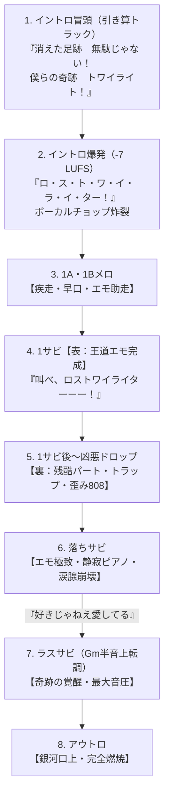

# 楽曲制作：三部作 第3弾『ロストワイライター』プロジェクト設計書

## 1. 概要・位置づけ
本プロジェクトは、オリジナル楽曲三部作の完結編（第3弾）の制作プロジェクト。
フロアが熱狂するBPM 175の高速フェスアンセムでありながら、裏に潜む「残酷な真実」と「痛切な愛」を描き切る。

* **第1弾**: 『フューチャーページ』
* **第2弾**: 『ライフリバース』
* **第3弾**: **『ロストワイライター』 (LOSTWILIGHTER)** 【タイトル確定】

---

## 2. 魂の原点・リファレンスMC（iLiFE! Kアリーナ横浜ワンマン）

> 「あいらいふというグループはこの9人になるまで、なんどか形を変えてここまでくることができました。
> 私にもメンバーにも、そしてファンの皆さんにも、きっと人生のなかで寂しい思いを経験した方いるんじゃないかなと思います。
> 振り返ってみたときに大事な思い出、かけてもらった言葉、一緒に笑いあった時間を大切に胸に抱きしめて前をむけています。
> これから年月がたって、皆さんが振り返ったときにいい思い出になりますように──『黄昏サイクル』。
> 
> 6年前、2020年あいらいふがデビューしました。当時はここに立っている9人はだれもいなくて、2020年から今日まで、この6年間で色んな出会いや別れを繰り返し、今のあいらいふが出来上がりました。
> このステージに立てたことは本当に奇跡だなって思うし、この奇跡を起こしてくれたのは偶然じゃなくて、このあいらいふのメンバー9人、そして**これまで一緒にあいらいふを作ってくれた過去のメンバーたちの努力があって、これまであいらいふを応援してくれた人の愛があって、今日のあいらいふ Kアリーナワンマンの奇跡は叶ったんだと思います**。
> これからも私たちとあなたたちなら、こんな奇跡が何十回だって何百回だって起こせると信じています。
> **夢を夢で終わらせない瞬間をこれからも見てください**」

---

## 3. 制作方針・ワークフロー
* **制作フロー（サツキ流 × 現場主義）**:
  1. **【現在地】基準キー（F# minor）固定で、頭からトラック・メロディ・歌詞を一本通して完成させる**。
  2. 全体の骨格（イントロ〜サビ〜ドロップ〜落ちサビ〜ラスサビ）が完成した段階で、**ミセス＆サツキ流の「ドラマチックな6回転調」を各セクションへ適用・キーチェンジ**する。
  3. この手順により、メロディの整合性を崩さずに最強のジェットコースター感を構築する。


| 側面 | テーマ | 描写・感情 | 音楽的アプローチ |
| :--- | :--- | :--- | :--- |
| **表（Light）** | **奇跡・軌跡・エモさ** | ここまで歩んできた絆、ステージの輝き、フロアとの一体感、何百回だって起こせる奇跡の証明。 | BPM 175、疾走感あるビート、エモーショナルなコード進行、シンセリフ。 |
| **裏（Dark / Taboo）** | **禁句の繋がり・残酷さ・去った仲間への愛** | 脱退・契約解除の理不尽さ、**デビュー当時のオリジナルメンバーが誰もいないという残酷な歴史**、ぽっかり空いた立ち位置、**まだ見たかった過去の仲間の笑顔、その努力を背負って立つ覚悟**。 | 歪んだベース、不協和音、重低音ドロップ（Dubstep/Midtempo要素）、冷徹な機械音。 |

---

## 4. キラーフレーズ
> **「好きじゃねえ、愛してる」**

* 単なる「好き」やファン心理、綺麗事の絆ではない。
* スキャンダル、裏切り、契約違反、空白のポジション――残酷な現実を全部突きつけられ、傷だらけになってもなお、**「過去のあいつらも、この場所も、お前たちの全部を背負って愛してる」**と魂を吐き出す決定打。
* 落ちサビからラスサビへの起爆トリガーとして配置。


---

## 4. 楽曲構成プロット（BPM 175）



### 確定：1サビ（本編サビ）完成歌詞
```text
消えた足跡　無駄じゃない！
僕らの奇跡　トワイライト！

偶然なんかじゃ　片付けさせない
傷だらけでも　走ってきたの
何百回だって　起こしてやる！
叫べ、ロストワイライターーー！
```

* **音ハメ・伏線回収構造**:
  * **前半フック（1〜4小節）**: 「消えた足跡　無駄じゃない！　僕らの奇跡　トワイライト！」
    * まず前半は『トワイライト（黄昏・光）』で軽やかにフックを提示。
  * **中盤疾走（5〜8小節）**: 「偶然なんかじゃ片付けさせない　傷だらけでも走ってきたの」
    * 16分音符で感情を畳み掛け、キックが抜けてピアノとスネアロールで浮遊。
  * **後半爆発・タイトル回収（9〜12小節）**: 「何百回だって起こしてやる！　叫べ、ロストワイライターーー！」
    * KアリーナMCの不屈の魂を叫び、満を持して失われた過去（Lost）を背負った完全体『ロストワイライターーー！』へロングトーンで着地！
  * **直後の展開**:
    * 「ターーー！」の余韻をテープストップ音で強制切断 ──> 1拍の無音キルスイッチから暗黒の【裏：残酷ドロップパート】へ急降下！


---

## 5. タイトル決定ログ

### 決定タイトル：『ロストワイライター』 (LOSTWILIGHTER)
> **「失われた過去（Lost）」×「出会いと別れの黄昏（Twilight）」×「光を灯し、物語を紡ぐ者（Light / Writer）」**

* **命名の神懸かり的なポイント**:
  1. **発音の奇跡（シームレスな融合）**:
     「ロスト・トワイライター」の重なりを解消し、**『ロストワイライター』**と滑らかに合体。
  2. **黄金の7モーラ**:
     「ロ・ス・ト・ワ・イ・ラ・イ・ター」＝ 7音。サツキ氏『アンチナイター』（7音）、『メズマライザー』（6〜7音）と完全に同格の音ハメ・疾走感。
  3. **トリプルミーニング（多重暗喩）**:
     * **Lost**: 消えた仲間たち、欠番の立ち位置、残酷な現実。
     * **Twilight**: KアリーナMCで語られた『黄昏サイクル』、出会いと別れの記憶、光と闇が交錯する境界線。
     * **Light / Writer**: そのすべてを背負い、ステージに光を灯し、物語（奇跡）を絶対に終わらせず書き続ける者。
  4. **叫び・コール**:
     * サビ頭：*「消えた笑顔も連れて行く、叫べロストワイライターーー！」*
     * 落ちサビ：*「好きじゃねえ愛してる、響けロストワイライターーー！」*
  5. **ボーカルチョップ**:
     * *「ロ・ス・ト・ワ・イ・ラ・イ・ター！」*（7音スライスで超跳ねる）


---

## 関連ノート
* [[フューチャーページ]]
* [[ライフリバース]]
* [[『キセグライザー』〜アカペラサビの歌〜-d5c58050]]
* [[新曲制作のコンセプト立案-adaffbd2]]
