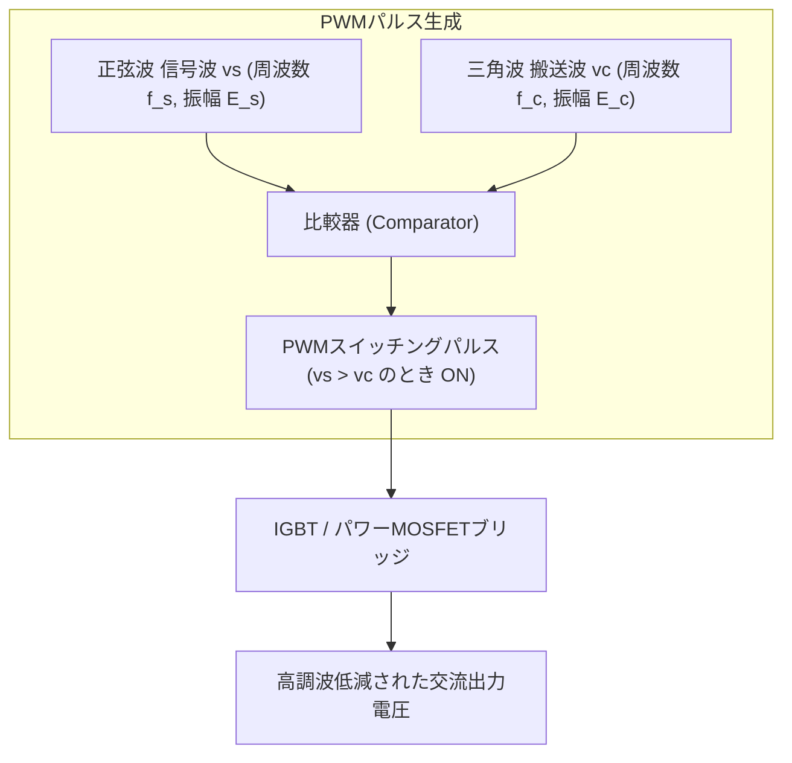

# ⚡ インバータ制御（PWM制御・変調率）

インバータ（逆変換装置）は、直流電力を任意の周波数・電圧の交流電力に変換する装置です。現代のパワーエレクトロニクスでは、出力波形を高調波の少ない滑らかな正弦波に近づけ、かつ電圧を連続制御するために**正弦波PWM（Pulse Width Modulation: パルス幅変調）制御**が広く用いられています。

---

## 1. 正弦波PWM制御の原理

正弦波PWM制御では、出力したい所望の交流波形である**「信号波（指令波 $v_s$：正弦波）」**と、スイッチング周波数を決める**「搬送波（キャリア $v_c$：三角波）」**の大小関係を比較器（コンパレータ）で比較し、ゲートパルスを生成します。

- **スイッチング動作**:
  - $v_s > v_c$ の期間：インバータ出力電位は $+E_d/2$（正パルス）
  - $v_s < v_c$ の期間：インバータ出力電位は $-E_d/2$（負パルス）
- パルスの「幅（Duty比）」を正弦波状に変化させることで、等価的な基本波電圧成分を正弦波にします。

---

## 2. 変調率（変調指数）と出力基本波電圧

### 電圧変調率（変調指数 $M$）の定義
信号波の振幅 $E_s$ と搬送波の振幅 $E_c$ の比を変調率 $M$ と呼びます：
$$M = \frac{E_s}{E_c}$$

### 出力電圧基本波成分
直流電源電圧を $E_d$ とすると、単相フルブリッジPWMインバータの出力基本波電圧の実効値 $V_1$ は：
$$V_1 = \frac{M E_d}{\sqrt{2}} \quad (0 \le M \le 1)$$
三相PWMインバータの線間電圧基本波実効値 $V_{L1}$ は：
$$V_{L1} = \frac{\sqrt{3} M E_d}{2 \sqrt{2}} \approx 0.612 \, M E_d$$

> [!NOTE]
> - **線形変調領域（$M \le 1$）**: 変調率 $M$ に比例して出力基本波電圧を線形に制御できます。
> - **過変調領域（$M > 1$）**: 出力電圧はさらに上がりますが、波形が歪み低次高調波が増加します。
> - **1パルスモード（矩形波運転）**: $M$ を極限まで大きくすると矩形波出力となり、最大出力電圧が得られます。

---

## 3. 周波数変調比（$N$）と高調波特性

- **周波数変調比 $N$**: 搬送波周波数 $f_c$ と信号波周波数 $f_s$ の比（$N = f_c / f_s$）。
- 三相インバータでは、対称性を保ち偶数次高調波を打ち消すため、$N$ は**3の奇数倍（例: 9, 15, 21, 27...）**が選ばれることが多いです。
- キャリア周波数 $f_c$ を高く（数kHz〜数十kHz）するほど、高調波がキャリア周波数付近の高周波帯にシフトするため、小形のフィルタ（$LC$）で容易に除去でき、低騒音化（可聴域外）が図れます。

---

## 関連ノート
- [[電験三種 機械科目 過去問攻略MOC]]
- [[パワーエレクトロニクスのチョッパ回路とインバータ]]
- [[単相半波整流回路]]
- [[三相誘導電動機のトルクの比例式と等価回路]]
