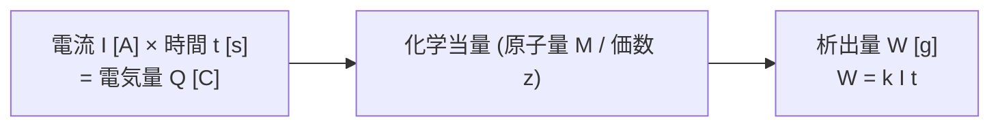

# ⚗️ ファラデーの電気分解の法則と電池

電気化学は電験三種「機械科目」の選択問題または必須小問として定期的に出題されます。電解精錬やめっき、蓄電池（鉛蓄電池・リチウムイオン電池）の充放電計算の基礎となるのが**ファラデーの電気分解の法則**です。

---

## 1. ファラデーの電気分解の法則

### 第1法則
電極に析出（または溶解）する物質の質量 $W \ [\text{g}]$ は、電解液を通過した**電気量 $Q = I t \ [\text{C} = \text{A}\cdot\text{s}]$ に比例**する。
$$W \propto Q = I t$$

### 第2法則
同じ電気量によって析出する物質の質量は、その物質の**化学当量（原子量 $M$ / イオンの価数 $z$）に比例**する。

### 統合公式
ファラデー定数を $F \approx 96,485 \ \text{C/mol}$（電験三種では $96,500 \ \text{C/mol}$ として与えられることが多い）、物質の原子量を $M$、価数を $z$、電気化学当量を $k \ [\text{g/C}]$ とすると：
$$W = k Q = k I t = \frac{M}{z F} I t \quad [\text{g}]$$

- **電気化学当量 $k$**:
  $$k = \frac{M}{z F} \quad [\text{g/C}]$$
- 電流効率（ファラデー効率）$\eta$ がある場合：
  $$W = \frac{M}{z F} I t \times \eta \quad [\text{g}]$$

---

## 2. 電池と充放電理論

### 鉛蓄電池の化学反応
電験三種で最も頻出の二次電池です。
- **陽極（正極）**: 二酸化鉛 $\text{PbO}_2$
- **陰極（負極）**: 海綿状鉛 $\text{Pb}$
- **電解液**: 希硫酸 $\text{H}_2\text{SO}_4$

$$\text{PbO}_2 + \text{Pb} + 2\text{H}_2\text{SO}_4 \underset{\text{充電}}{\overset{\text{放電}}{\rightleftarrows}} 2\text{PbSO}_4 + 2\text{H}_2\text{O}$$

- **放電時**:
  - 両極とも硫酸鉛 $\text{PbSO}_4$ に変化し、重量が増加。
  - 水 $\text{H}_2\text{O}$ が生成されるため、**電解液の比重が低下**（$1.2 \sim 1.3 \to 1.1 \sim 1.15$）。
- **起電力**: 約 $2.0 \sim 2.1 \ \text{V}$ / セル。

### 電池の効率
1. **容量効率（Ah効率）**:
   $$\eta_C = \frac{\text{放電電気量 } [A\cdot h]}{\text{充電電気量 } [A\cdot h]} \times 100 \ [\%] \quad (\approx 85 \sim 95\%)$$
2. **電力量効率（Wh効率）**:
   $$\eta_W = \frac{\text{放電電力量 } [W\cdot h]}{\text{充電電力量 } [W\cdot h]} \times 100 = \eta_C \times \frac{\text{平均放電電圧}}{\text{平均充電電圧}} \quad (\approx 70 \sim 80\%)$$

---

## 関連ノート
- [[電験三種 機械科目 過去問攻略MOC]]
- [[銅損と電流密度]]
- [[誘導加熱]]
- [[電験三種 頻出要点攻略 MOC]]
