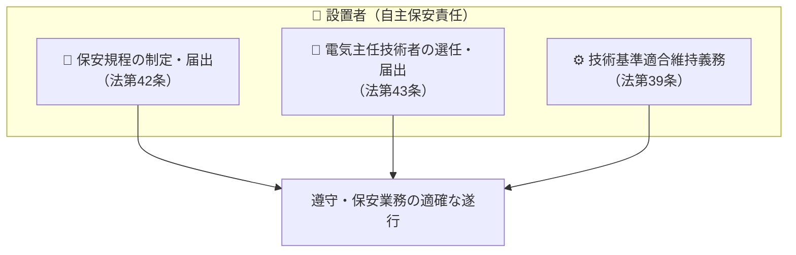

# ⚖️ 事業用電気工作物の自主保安体制と保安規程・主任技術者

電気事業法において、事業用電気工作物（自家用電気工作物を含む）の保安は、設置者自らが責任を持って維持・管理する**「自主保安体制」**が原則となっています。その中核を担うのが**保安規程の制定・届出**と**主任技術者の選任・届出**です。

---

## 1. 自主保安の3大柱

---

## 2. 保安規程（法第42条・施行規則第50条）

### 概要と手続き
- **義務**: 事業用電気工作物を設置する者は、保安を確保するため**保安規程**を定め、使用開始前に**経済産業大臣（または産業保安監督部長）に届出**しなければならない（変更時も同様に遅滞なく届出）。
- **遵守義務**: 設置者およびその従業者は、保安規程を守らなければならない。

### 保安規程に定めるべき事項（施行規則第50条・頻出ポイント）
1. 保安管理の**職務組織**（指揮命令系統、責任と権限）
2. 保安教育および訓練
3. 工事・維持・運用に関する**巡視・点検・測定・試験**の基準
4. 事故その他**非常時の応急措置**
5. 工作物の工事・維持・運用に関する**記録の作成・保存**（3年間）
6. 構内図面等の整備

---

## 3. 電気主任技術者制度（法第43条）

### 免状の種類と監督範囲
設置者は、電気工作物の工事・維持・運用の保安を監督させるため、免状取得者の中から主任技術者を選任しなければなりません。

| 免状の種別 | 監督できる電気工作物の範囲 | 出題ポイント |
| :--- | :--- | :--- |
| **第一種** | **すべての事業用電気工作物**（無制限） | 発電所、50万V基幹送変電所など |
| **第二種** | **電圧 $170,000 \ \text{V}$ 未満**の事業用電気工作物 | 大規模工場、超高圧受電設備 |
| **第三種** | **電圧 $50,000 \ \text{V}$ 未満**の事業用電気工作物 （※出力5,000kW以上の発電所を除く） | ビル・一般工場・太陽光発電（小規模） |

> [!IMPORTANT]
> - 主任技術者を選任したとき、または解任したときは、**遅滞なく届出**が必要。
> - 選任要件の緩和制度として、一定規模以下（受電電圧7,000V以下、需要設備容量等）では保安法人や個人受託者への**保安管理業務外部委託承認制度**が認められています。

---

## 関連ノート
- [[電験三種 法規科目 過去問攻略MOC]]
- [[保護協調と事故報告義務（電気関係報告規則）]]
- [[電気工事士の作業範囲（第一種・第二種）]]
- [[電気工事業法の測定器具]]
