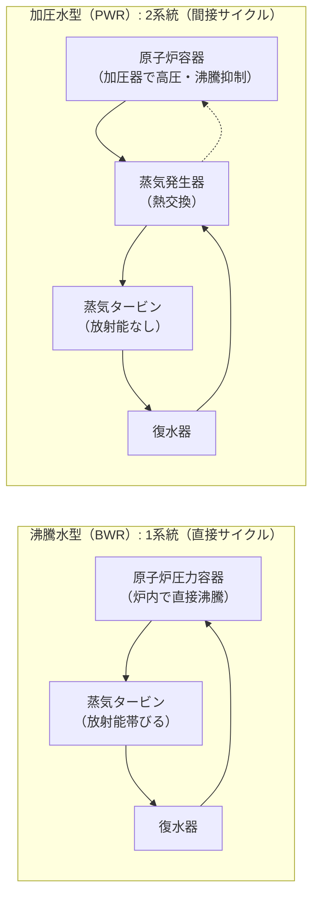

# ⚛️ 原子力発電の原理と軽水炉（BWR・PWR）

原子力発電は、ウラン235（$^{235}\text{U}$）などの核分裂性物質が熱中性子を吸収して核分裂する際に放出される**核分裂エネルギー（熱エネルギー）**を利用して高温高圧の蒸気を作り、蒸気タービンを回して発電する方式です。日本の商業用原子炉では、減速材と冷却材に軽水（普通の水）を用いる**軽水炉（BWRおよびPWR）**が採用されています。

---

## 1. 核分裂連鎖反応と構成要素

- **燃料**: 低濃縮ウラン（$^{235}\text{U}$ の割合が $3 \sim 5\%$ 程度、二酸化ウラン $\text{UO}_2$ ペレットをジルコニウム合金の被覆管に封入）。
- **減速材**: 核分裂で生じる高速中性子を、次の核分裂を起こしやすい**熱中性子**（低速）に減速させる（軽水炉では**軽水**が担当）。
- **冷却材**: 核分裂熱を炉心から奪い、蒸気発生器やタービンへ輸送する（軽水炉では**軽水**が担当）。
- **制御棒**: 中性子を強く吸収する材料（炭化ホウ素 $\text{B}_4\text{C}$ やハフニウム、銀・インジウム・カドミウム合金など）で作られ、炉心の反応度を制御・停止する。

---

## 2. 沸騰水型（BWR）と加圧水型（PWR）の徹底比較

電験三種で最も問われるのが、**BWR（Boiling Water Reactor）** と **PWR（Pressurized Water Reactor）** の構造と動作の違いです。

### 比較一覧表

| 項目 | 沸騰水型原子炉（BWR） | 加圧水型原子炉（PWR） |
| :--- | :--- | :--- |
| **サイクル構成** | **直接サイクル**（1系統） | **間接サイクル**（1次系＋2次系の2系統） |
| **炉内での沸騰** | **炉心内で冷却水を沸騰**させ、蒸気を生成 | **加圧器**により高圧（約15〜16MPa）に保ち、**炉内沸騰を防止** |
| **蒸気発生器** | **不要**（直接タービンへ導く） | **必要**（1次系の熱で2次系の水を沸騰させる） |
| **タービンへの放射能** | 蒸気が炉心を通るため、**タービン系にも微量の放射能が付着**する（遮蔽対策が必要） | 1次系と2次系が完全に隔離されているため、**タービン系に放射能は持ち込まれない** |
| **制御棒の挿入方向** | **下部から上方へ挿入** （炉心上部に気泡＝ボイドが溜まるため） | **上部から重力落下で挿入** （安全性が高い） |
| **圧力容器の大きさ** | 蒸気分離器・乾燥器を内蔵するため**大形**（肉厚は比較的薄い：約7MPa） | 蒸気発生器が別置のため**小形**（ただし超高圧に耐えるため肉厚が極めて厚い：約15MPa） |
| **主な電力会社** | 東京電力、東北電力、中部電力など（東日本中心） | 関西電力、九州電力、四国電力など（西日本中心） |

---

## 3. 自己制御性（固有の安全性）

軽水炉は、出力が上昇したときに自然に出力を低下させようとする**負の反応度係数**（自己制御性）を持っています。
1. **ボイド効果（ボイド係数が負）**:
   - 出力が増加して冷却水温度が上がると気泡（ボイド）が増加。減速材としての水密度が減少し、熱中性子が減って核分裂が抑制される。
2. **ドップラー効果（ドップラー係数が負）**:
   - 燃料温度が上昇すると、$^{238}\text{U}$ による中性子共鳴吸収が増加し、核分裂反応が抑えられる。

---

## 関連ノート
- [[電験三種 電力科目 過去問攻略MOC]]
- [[汽力発電の熱サイクルと熱効率]]
- [[水力発電所の運用と揚水発電]]
- [[電験三種 頻出要点攻略 MOC]]
