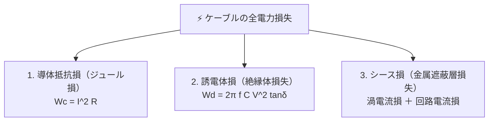

# 🚇 地中電線路の電力損失（誘電体損・シース損）と許容電流

地中送配電線路では、電力ケーブル（主に架橋ポリエチレン絶縁ビニルシースケーブル：**CVケーブル**）が使用されます。架空電線路と異なり、導体の抵抗損（銅損）以外に**誘電体損**や**シース損**などの特有の損失が発生し、これらが発熱源となってケーブルの**許容電流**を制限します。

---

## 1. 電力ケーブルの3大電力損失

### ① 導体抵抗損（$W_c$）
導体に電流 $I$ が流れることで発生するジュール熱：
$$W_c = I^2 R \quad [\text{W/m}]$$
（交流では表皮効果および近接効果により、実効抵抗 $R$ は直流抵抗より大きくなります）

### ② 誘電体損（$W_d$）
交流高電圧が絶縁体に印加されることで生じる損失。静電容量 $C$、対地電圧 $V$、周波数 $f$、誘電正接（力率）$\tan\delta$ より：
$$W_d = \omega C V^2 \tan\delta = 2\pi f C V^2 \tan\delta \quad [\text{W/m}]$$
- 電圧 $V$ の**2乗に比例**するため、超高圧ケーブル（66kV〜500kV）になるほど重要。
- CVケーブルは $\tan\delta$ および比誘電率 $\varepsilon_r$ が極めて小さいため、従来のOFケーブルに比べて誘電体損が大幅に低減されています。

### ③ シース損（$W_s$）
導体電流がつくる交番磁束が金属シース（遮蔽銅テープや鉛被）を鎖交することによって生じる損失。
- **シース回路損**: ケーブル両端でシースを接地した場合、シースに循環電流が流れて生じる損失。長距離線路では**クロスボンド接地方式**（シースを相互にクロス接続して誘起起電力を相殺）を採用して大幅に抑制します。
- **シース渦電流損**: シース自体の断面内で局所的に流れる渦電流による損失。

---

## 2. 許容電流（連続許容電流）の決定要因

ケーブルに流せる電流の限界（許容電流 $I_a$）は、導体の**最高許容温度**によって決定されます。
- **CVケーブルの最高許容温度**:
  - 連続時: **$90 \ ^\circ\text{C}$**
  - 短絡時（瞬時）: **$230 \ ^\circ\text{C}$**

### 熱回路方程式
発生熱量（$W_c + W_d + W_s$）と周囲への放熱による熱平衡：
$$I_a = \sqrt{\frac{\theta_m - \theta_0 - W_d \left( \frac{R_{th1}}{2} + R_{th2} + R_{th3} \right)}{R \left( R_{th1} + R_{th2} + R_{th3} \right)}} \quad [\text{A}]$$
（$\theta_m$: 最高許容温度、$\theta_0$: 周囲基底温度、$R_{th}$: 熱抵抗）

> [!IMPORTANT]
> 複数条のケーブルを同一管路や暗きょに密接して敷設（多条敷設）すると、相互加熱により放熱性が悪化するため、**電流減少係数**を乗じて許容電流を低減させる必要があります。

---

## 3. 地中電線路の布設方式の比較

1. **直接埋設式**: 工費が安いが、掘り返しが必要。埋設深さ（車両の重量受ける場所 $1.0\,\text{m}$、その他 $0.6\,\text{m}$）。
2. **管路式**: 道路下に多条の管を埋設しマンホールで接続。保守・ケーブル引き替えが容易。
3. **暗きょ式（洞道式）**: 地下にトンネル（洞道）を構築。多数のケーブルを整然と収容でき、冷却・点検性に優れる。

---

## 関連ノート
- [[電験三種 電力科目 過去問攻略MOC]]
- [[地中電線路の施設基準（埋設深さ）]]
- [[送電線の電圧降下近似式]]
- [[送電線のフェランチ効果と自己励磁現象]]
