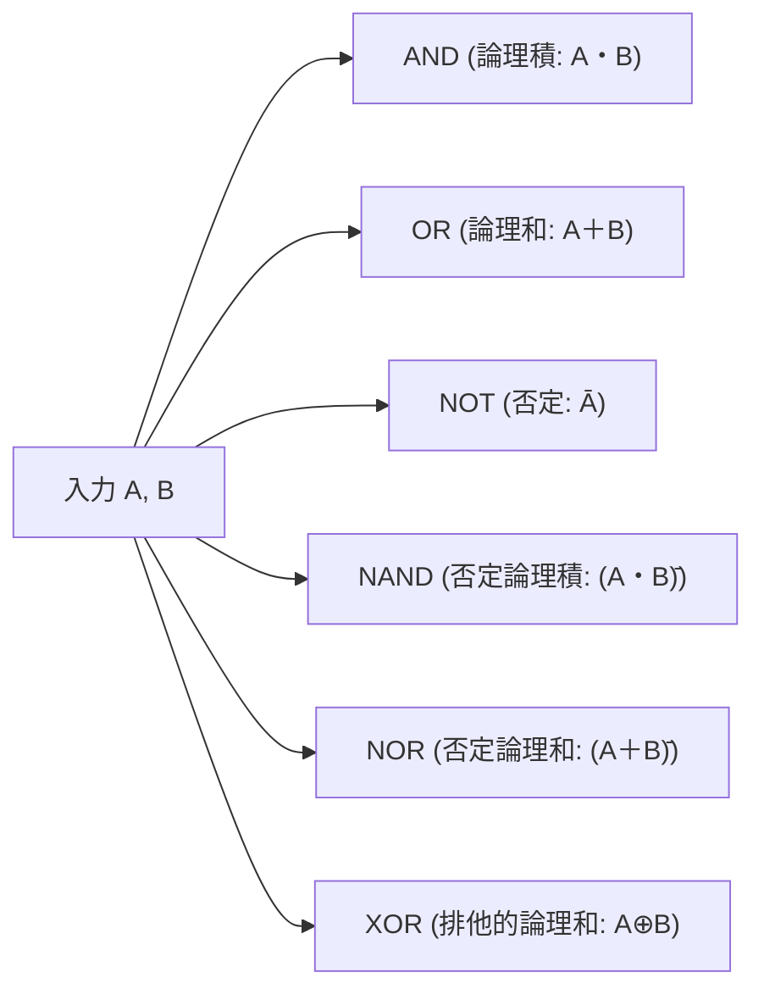

# 💻 論理回路と論理式（ブール代数・ド・モルガンの定理）

電験三種「機械科目」の情報分野では、基本論理ゲート（AND, OR, NOT, NAND, NOR, XOR）、ブール代数の公式、および**ド・モルガンの定理を用いた論理式の簡単化**がほぼ毎年出題されます。

---

## 1. 基本論理ゲートと真理値表

| ゲート名 | 記号 | 論理式 | 真理値表 $(A, B \to Y)$ |
| :--- | :---: | :---: | :---: |
| **AND** | 積 | $Y = A \cdot B$ | $(0,0\to 0), (0,1\to 0), (1,0\to 0), (1,1\to 1)$ |
| **OR** | 和 | $Y = A + B$ | $(0,0\to 0), (0,1\to 1), (1,0\to 1), (1,1\to 1)$ |
| **NOT** | 否定 | $Y = \overline{A}$ | $(0 \to 1), (1 \to 0)$ |
| **NAND** | 否定積 | $Y = \overline{A \cdot B}$ | $(0,0\to 1), (0,1\to 1), (1,0\to 1), (1,1\to 0)$ |
| **NOR** | 否定和 | $Y = \overline{A + B}$ | $(0,0\to 1), (0,1\to 0), (1,0\to 0), (1,1\to 0)$ |
| **XOR** | 排他的論理和 | $Y = A \oplus B = \overline{A}B + A\overline{B}$ | $(0,0\to 0), (0,1\to 1), (1,0\to 1), (1,1\to 0)$（不一致で1） |

---

## 2. ブール代数の重要定理

1. **同一律（巾等律）**:
   $$A \cdot A = A, \quad A + A = A$$
2. **補元律**:
   $$A \cdot \overline{A} = 0, \quad A + \overline{A} = 1$$
3. **二重否定**:
   $$\overline{\overline{A}} = A$$
4. **定数との演算**:
   $$A \cdot 0 = 0, \quad A \cdot 1 = A, \quad A + 0 = A, \quad A + 1 = 1$$
5. **分配律**:
   $$A \cdot (B + C) = A\cdot B + A\cdot C$$
   $$A + (B \cdot C) = (A + B) \cdot (A + C) \quad \text{★電験頻出！}$$
6. **吸収律**:
   $$A + A \cdot B = A, \quad A \cdot (A + B) = A$$
   $$A + \overline{A}\cdot B = A + B \quad \text{★簡単化の要！}$$

---

## 3. ド・モルガンの定理（De Morgan's Laws）

論理式のバー（否定）を分割または結合する最重要定理：
$$\overline{A \cdot B} = \overline{A} + \overline{B}$$
$$\overline{A + B} = \overline{A} \cdot \overline{B}$$

> [!TIP]
> **「バーを割って、符号を変える（積 $\leftrightarrow$ 和）」** と覚えます。3変数以上でも同様に成立：
> $$\overline{A \cdot B \cdot C} = \overline{A} + \overline{B} + \overline{C}$$

---

## 4. NAND・NORの完全系（万能性）
NANDゲートまたはNORゲートのみを組み合わせることで、**すべての論理回路（NOT, AND, OR）を構成**できます。
- NANDによるNOT: $\overline{A \cdot A} = \overline{A}$
- NANDによるAND: $\overline{\overline{A \cdot B}} = A \cdot B$
- NANDによるOR: $\overline{\overline{A} \cdot \overline{B}} = \overline{\overline{A}} + \overline{\overline{B}} = A + B$

---

## 関連ノート
- [[電験三種 機械科目 過去問攻略MOC]]
- [[自動制御の伝達関数と周波数応答・ブロック線図]]
- [[電験三種 頻出要点攻略 MOC]]
