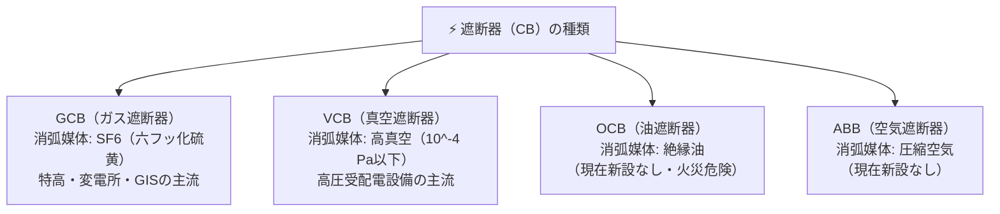

# ⚡ 遮断器の種類（GCB・VCB）と消弧原理

変電所や受配電設備において、**遮断器（Circuit Breaker: CB）**は通常時の負荷電流の開閉だけでなく、地絡や短絡などの事故時に発生する**莫大な短絡事故電流を安全かつ急速に遮断**する責務を持ちます。電流遮断時に電極間に生じるアークをいかに消すか（**消弧原理**）によって種類が分かれます。

---

## 1. 開閉機器の役割の違い

- **断路器（DS: Disconnecting Switch）**: 電流が流れていない状態で回路を確実に隔離・開閉する（アーク消弧能力なし。負荷電流遮断厳禁）。
- **負荷開閉器（LBS: Load Break Switch）**: 通常の定格負荷電流を開閉できるが、事故電流の遮断はできない。
- **遮断器（CB: Circuit Breaker）**: 負荷電流はもちろん、大電流の**短絡事故電流を高速遮断**できる。

---

## 2. 主要な遮断器の種類と消弧媒体

---

## 3. GCBとVCBの特性比較

| 項目 | ガス遮断器（GCB） | 真空遮断器（VCB） |
| :--- | :--- | :--- |
| **消弧媒体** | **$\text{SF}_6$（六フッ化硫黄ガス）** | **高真空（$10^{-4} \ \text{Pa}$ 以下）** |
| **消弧原理** | 強力な**負イオン形成能（電子付着性）**により自由電子を捕獲し、アーク柱を急速に冷却・絶縁回復 | 真空中での**金属蒸気の急速な拡散**と電極への再凝縮による極めて高い絶縁耐力 |
| **適用電圧範囲** | **特別高圧〜超高圧（72kV〜500kV）** ※ガス絶縁開閉装置（GIS）の中核 | **高圧（3.3kV〜33kV）** ※ビル・工場などの受配電盤（キュービクル）のデファクトスタンダード |
| **特徴・長所** | ・遮断性能が極めて高い ・不燃性・無毒・無臭 ・小形化・低騒音 | ・小形・軽量 ・保守点検が容易で長寿命 ・火災の危険性が皆無 |
| **留意点・欠点** | ・$\text{SF}_6$ は地球温暖化係数（GWP）が約23,900倍と極めて高いため、**回収義務**がある | ・誘導性微小電流（無負荷変圧器など）を遮断する際、**電流裁断現象（チョッピング）**により異常過電圧を生じやすいためサージキラーが必要 |

> [!TIP]
> - **$\text{SF}_6$ ガスの電気的特性**:
>   - 絶縁耐力は空気の約 **2〜3倍**（0.3MPa程度で変圧器油と同等以上）。
>   - 消弧能力は空気の約 **100倍**。
>   - 熱伝導率が高く、アーク温度の冷却速度が極めて速い。

---

## 関連ノート
- [[電験三種 電力科目 過去問攻略MOC]]
- [[避雷器（酸化亜鉛形避雷器）と制限電圧]]
- [[計器用変成器（VT・CT）の取扱いと留意点]]
- [[高圧・特別高圧電路の耐電圧試験]]
