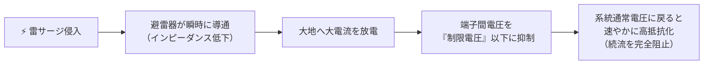

# 🌩️ 避雷器（酸化亜鉛形避雷器）と制限電圧

**避雷器（Lightning Arrester: LA / Surge Arrester）**は、雷サージや開閉サージなどの異常電圧が変電所や受電設備に侵入した際、大地に放電して過電圧を低減させ、**機器の絶縁破壊を防止**するとともに、放電後は速やかに**続流（商用周波数電流）を遮断して系統を通常状態に復帰**させる保護装置です。

---

## 1. 避雷器の動作とキーワード

### 必須専門用語の定義
- **制限電圧（Residual Voltage）**:
  - 避雷器がサージ電流（公称放電電流）を大地へ放電している最中に、避雷器の**端子間に残留する電圧**の波高値。
  - 変圧器などの保護対象機器の基準衝撃絶縁強度（BIL: Basic Impulse Insulation Level）は、この**制限電圧よりも十分高く設計**（保護余裕 $20\%$ 以上）されます。
- **続流（Follow Current）**:
  - サージ放電に引き続いて、系統の通常電源（商用周波数）から供給されて避雷器を流れ続けようとする電流。これを速やかに遮断することが避雷器の絶対要件です。

---

## 2. 酸化亜鉛形（ZnO）ギャップレス避雷器

かつては炭化ケイ素（SiC）素子と直列ギャップを組み合わせた避雷器が主流でしたが、現在は**酸化亜鉛（$\text{ZnO}$）**を用いた**ギャップレス避雷器**が全面的に採用されています。

### $\text{ZnO}$ 素子の優れた特徴
1. **極めて優れた非直線抵抗特性（バリスタ特性）**:
   - 通常の定格商用電圧ではメガオーム単位の**極めて高い絶縁抵抗**を示し、漏れ電流はマイクロアンペア（$\mu\text{A}$）単位しか流れません。
   - サージなどの異常過電圧が印加されると、瞬時に**極めて低い抵抗値**へと遷移し、数万アンペアの大電流を通過させます。
2. **直列ギャップが不要（ギャップレス）**:
   - ギャップがないため放電遅れがなく、急峻な雷サージに対しても**極めて優れた応答性**を発揮します。
   - 放電終了後も電圧が低下すれば自然に高抵抗に戻るため、**続流が原理的に流れません**。
3. **小形・軽量・多重サージ耐量**:
   - 構造が簡単で小形化でき、短時間の連続多重雷サージにも耐えられます。

---

## 3. 避雷器の施設場所（電気設備技術基準・解釈 第37条）

電験三種法規・電力で頻出の避雷器施設義務場所（高圧・特高）：
1. 発電所・変電所またはこれに準ずる場所の**架空電線の引込口および引出口**
2. 架空電線路に接続する**配電用変圧器の高圧側および特高側**
3. 高圧または特高の**架空電線路から供給を受ける需要家の受電点引込口**
4. 架空電線路と地中電線路の接続点

> [!IMPORTANT]
> 避雷器は、保護対象機器（特に高価な主変圧器）に**できるだけ接近して施設**します。離隔距離が長くなると、サージの往復反射によって機器端子のサージ電圧が高くなり、保護効果が低下します。

---

## 関連ノート
- [[電験三種 電力科目 過去問攻略MOC]]
- [[電験三種 法規科目 過去問攻略MOC]]
- [[遮断器の種類（GCB・VCB）と消弧原理]]
- [[高圧・特別高圧電路の耐電圧試験]]
