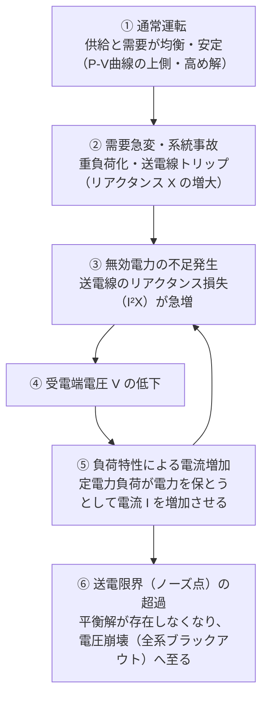

# 電圧安定度と電圧崩壊

電力系統において、負荷の変動や系統事故等の外乱に対して受電端の電圧を許容範囲内に安定して維持できる能力（**電圧安定度**）、および無効電力の需給破綻により系統電圧が制御不能となって急激に低下・停止する現象（**電圧崩壊 / 電圧破壊**）。

---

## 1. 無効電力と受電端電圧の基本関係式

送電端電圧（または電源起電力）を $E$（または $V_s \angle\delta$）、受電端電圧を $V$（または $V_r \angle 0$）、線路リアクタンスを $X$ としたとき、受電端の無効電力 $Q$（遅れ無効電力を正とする）は以下の式で表されます。

$$Q = \frac{E V \cos\delta - V^2}{X}$$

> [!NOTE] 有効電力 $P$ の式
> $$P = \frac{E V \sin\delta}{X}$$
> これら $P$ と $Q$ の連立関係から、電圧 $V$ と有効電力 $P$ の軌跡を描いたものが [[P-V曲線（ノーズカーブ）]] です。

---

## 2. 電圧崩壊（電圧破壊）のメカニズム

電圧崩壊は、単なる機器故障ではなく、**無効電力需給のアンバランスが正のフィードバック（悪循環）を生む現象**です。

### 電圧崩壊を防止・改善する対策
1. **調相設備の投入**:
   - 負荷端に[[力率改善用コンデンサ容量|電力用コンデンサ（進相コンデンサ）]]を投入し、不足する無効電力を局所的に補償する。
2. **送電線リアクタンス $X$ の低減**:
   - 送電線の多導体化、並列回線化、直列コンデンサの挿入。
3. **送電端電圧 $E$ の引き上げ**:
   - 発電機の励磁強化（界磁調整）による無効電力供給。
4. **[[負荷の電圧特性]]の管理**:
   - 電圧低下時に負荷を適宜遮断（不足電圧負荷遮断：UVLS）し、ノーズ点手前で安定余裕を確保する。

## 関連ノート
- [[P-V曲線（ノーズカーブ）]] - 電圧安定性を視覚化する特性曲線
- [[負荷の電圧特性]] - 定電力負荷・定電流負荷・定インピーダンス負荷と電圧安定性
- [[送電線の電圧降下近似式]] - 送電線の電圧降下と無効電力 $Q$ の関係
- [[力率改善用コンデンサ容量]] - 無効電力補償と電圧改善
- [[電気機器設計の予備知識（授業まとめMOC）]]
