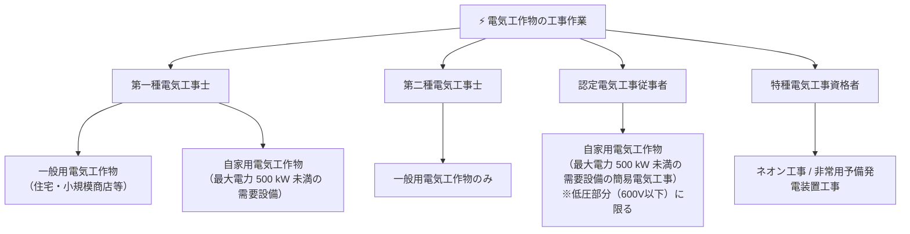

# 🔧 電気工事士の作業範囲（第一種・第二種）

電気工事士法は、電気工事の欠陥による災害の発生を防止するため、電気工作物の工事に従事する者の資格及び義務を定めた法律です。電験三種では、**免状の種類と工事できる電気工作物の範囲**が頻出です。

---

## 1. 免状・資格と作業範囲の比較

---

## 2. 区分別作業可能範囲一覧表

| 資格区分 | 一般用電気工作物 | 自家用電気工作物（最大電力500kW未満） | 500kW以上の自家用・事業用 |
| :--- | :---: | :---: | :---: |
| **第一種電気工事士** | **◯ 作業可能** | **◯ 高圧・低圧ともに可能** | ✕（工事士法適用外・主任技術者の指示下） |
| **第二種電気工事士** | **◯ 作業可能** | ✕ 作業不可 | ✕ |
| **認定電気工事従事者** | ✕ 作業不可 | **◯ 簡易電気工事のみ**（低圧電路に限る） | ✕ |
| **特種電気工事資格者** | 該当特殊工事のみ | 該当特殊工事のみ（ネオン工事・発電装置） | ✕ |

> [!NOTE]
> - **簡易電気工事**: 最大電力 $500 \ \text{kW}$ 未満の自家用電気工作物のうち、受電電圧 $600 \ \text{V}$ 以下の低圧で使用する電気工作物の工事を指します（電線路工事を除く）。
> - 第一種電気工事士は試験合格後、所定の実務経験（3年以上、大学・高専卒等は2年以上）を経て免状が交付されます。

---

## 3. 電気工事士でなくても従事できる軽微な作業
電験三種試験では「電気工事士の資格が不要な作業（軽微な工事）」も選択肢としてよく出題されます。
- 電圧 $60 \ \text{V}$ 以下の電路で使用する差込み接続器、ソケット、ローゼット等の取付
- 蓄電池の端子に電線をねじ止めする作業
- 電力量計、ヒューズ、ボルト類等の取替え作業
- 露出型ナイフスイッチのヒューズ取替え

---

## 関連ノート
- [[電験三種 法規科目 過去問攻略MOC]]
- [[事業用電気工作物の自主保安体制と保安規程・主任技術者]]
- [[電気工事業法の測定器具]]
- [[低圧屋内配線工事の種類と施設場所]]
