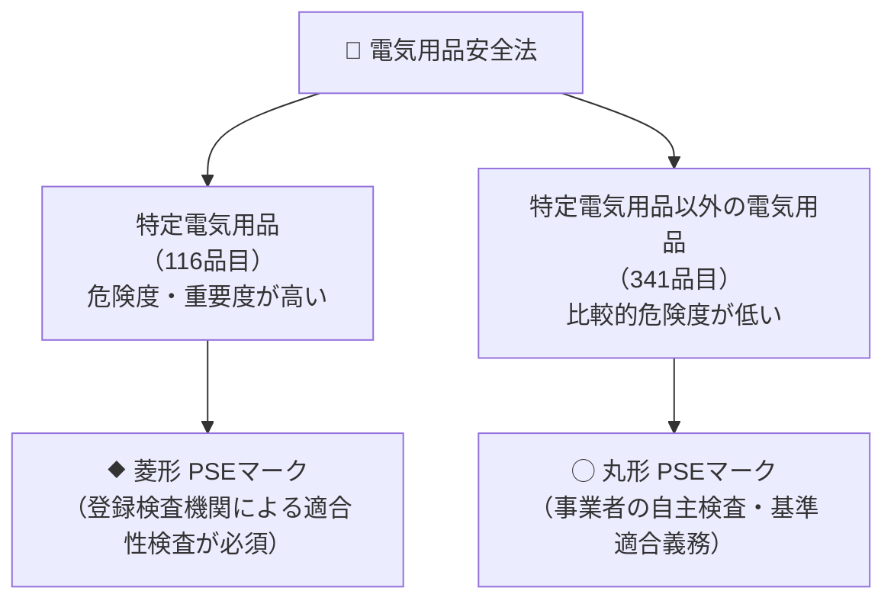

# 🛡️ 電気用品安全法（特定電気用品とPSEマーク）

電気用品安全法（DENAN法）は、電気用品による危険及び障害の発生を防止することを目的とした法律です。製造・輸入事業者による自主的な安全確保を基本とし、製品の危険度に応じて**特定電気用品（菱形PSE）**と**特定電気用品以外の電気用品（丸形PSE）**に区分されています。

---

## 1. 2つの電気用品とPSEマークの区分

---

## 2. 特定電気用品とそれ以外の製品例

| 区分 | マーク | 代表的な製品例 | 適合性検査（第三者機関） |
| :--- | :---: | :--- | :---: |
| **特定電気用品** （構造上危険度が高いもの、長時間無監視で使用されるもの） | **⯁ 菱形PSE** | ・コード、ケーブル（ゴムコード等） ・配線器具（スイッチ、コンセント、プラグ） ・変圧器、安定器、小型単相変圧器 ・電熱器具（電気温水器、電気サウナ） ・電動力応用遊戯器具 | **義務あり** （登録検査機関による適合性同等証明書の保存） |
| **特定電気用品以外の電気用品** | **◯ 丸形PSE** | ・家庭用電熱器具（電気こたつ、アイロン、トースター） ・家庭用電動力応用器具（冷蔵庫、洗濯機、扇風機） ・電子応用機械器具（テレビ、パソコン用ディスプレイ） ・リチウムイオン蓄電池 | 事業者の自主検査（技術基準適合の自己確認）のみ |

---

## 3. 事業者の主な義務と出題ポイント

1. **事業の届出（法第3条）**:
   - 製造または輸入の事業を行う者は、事業開始の日から**30日以内**に経済産業大臣に届け出なければならない。
2. **基準適合義務（法第8条）**:
   - 製造または輸入する電気用品が省令で定める**技術基準に適合**するようにしなければならない。
3. **自主検査および検査記録の保存（法第8条第2項）**:
   - 経済産業省令で定める検査（完成品検査）を行い、その検査記録を作成し、検査の日から**3年間保存**しなければならない。
4. **特定電気用品の適合性検査（法第9条）**:
   - 経済産業大臣の登録を受けた**登録検査機関**の適合性検査を受け、証明書を交付され保存していなければ表示を付してはならない。
5. **表示のない電気用品の販売制限（法第27条）**:
   - PSEマークが付されていない電気用品は、原則として**販売し、または販売の目的で陳列してはならない**。

---

## 関連ノート
- [[電験三種 法規科目 過去問攻略MOC]]
- [[事業用電気工作物の自主保安体制と保安規程・主任技術者]]
- [[電気工事士の作業範囲（第一種・第二種）]]
- [[電圧の種別区分（低圧・高圧・特別高圧）]]
