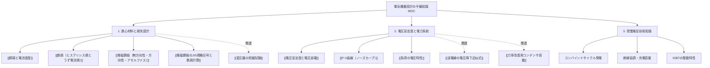

# 📖 電気機器設計の予備知識（授業まとめMOC）

学校の授業「電気機器設計の予備知識」の配布プリント・演習問題、および関連する電力系統特性（電圧安定度・P-V曲線・電圧崩壊）の要点・公式・解法プロセスを体系的に集約したまとめノート（Map of Content: MOC）です。

---

## 🗺️ 知識構造マップ

---

## 1. ⚙️ 電気機器設計の予備知識（演習プリント問4〜問10）

### 【問4】[[銅損と電流密度]]
- **重要理論・公式**:
  - 電流密度 $\Delta \ [\text{A/mm}^2]$、導体断面積 $q \ [\text{mm}^2]$ より、電流は $I = \Delta q \ [\text{A}]$。
  - 導体抵抗 $R = 0.021 \frac{\ell}{q} \ [\Omega]$ より、ジュール熱（銅損）は次式：
    $$W_c = R I^2 = 0.021 \frac{\ell}{q} (\Delta q)^2 = 0.021 \Delta^2 q \ell \quad [\text{W}]$$
  - 銅の比重（密度）8.9 を用いた**単位重量あたりの銅損 $w_c$**:
    $$w_c = \frac{0.021 \Delta^2}{8.9} \approx 0.00236 \Delta^2 \quad [\text{W/kg}]$$
- **穴埋め解答**: ① 電流密度、② $\Delta q$、③ 密度、④ 単位重量、⑤ $\frac{0.021 \Delta^2}{8.9}$（または $0.00236 \Delta^2$）、⑥ 銅損

---

### 【問5】[[鉄損（ヒステリシス損とうず電流損）]]
- **変圧器鉄心材料の4大要求性能**:
  1. **飽和磁束密度**が大きい
  2. **透磁率**（および電気抵抗率）が大きい
  3. **保持力**が小さい
  4. **残留磁気**が小さい
- **損失の低減アプローチ**:
  - **うず電流損**: 抵抗率を大きくする、および薄板の**積層構造**（積層にすること）により渦電流を抑える。
  - **ヒステリシス損**: 保持力と残留磁気を小さくすることで低減。
  - 鉄損が少ないほど変圧器の**効率**が向上する。
- **穴埋め解答**: ① 飽和磁束密度、② 透磁率、③ 積層構造（積層にすること）、④ ヒステリシス損、⑤ 効率

---

### 【問6】[[電磁鋼板（無方向性・方向性・アモルファス）]]
- **材料分類**:
  1. **無方向性電磁鋼帯**: ケイ素（Si）含有量 約 **3%**。全方向に磁化。
  2. **方向性電磁鋼帯**: **磁化の容易軸**（圧延方向）を揃えた鋼帯。
  3. **アモルファス電磁薄帯**: 溶融金属を **$10^5 \sim 10^6 \ \text{K/s}$** で**急冷**した非結晶金属。
- **アモルファス薄帯の特性比較**:
  - **長所**: 抵抗率が約 **3倍**、鉄損が約 **1/6** と極めて小さい。
  - **欠点**: 飽和磁束密度が約 **80%** と小さい、**硬く**脆く加工性が悪い、磁気ひずみ大で**騒音**が大きい。
- **穴埋め解答**: ① 3、② 磁化の容易軸、③ 急冷、④ アモルファス、⑤ 3、⑥ かたく（硬く）、⑦ 騒音

---

### 【問7・問8】[[電磁鋼板のJIS規格記号と鉄損計算]]
- **JIS規格記号形式**: `□□ - □□□`（例: `50A310`, `30G140`）
  - 先頭2桁: 板厚 $[\text{mm}] \times 100$（`50` $\to 0.50\,\text{mm}$、`30` $\to 0.30\,\text{mm}$）
  - 種類記号:
    - **A**: **無方向性**電磁鋼帯
    - **G**: 方向性電磁鋼帯（**普通** / 高磁束密度）
    - **P**: 方向性電磁鋼帯（**高磁束密度材料** / 低鉄損）
    - **R**: 方向性電磁鋼帯（**磁気ドメイン制御材**）
  - 末尾3桁: 単位重量あたり**鉄損の測定値** $[\text{W/kg}] \times 100$
- **任意磁束密度 $B$ での鉄損計算式**（鉄損は $B^2$ に比例）:
  - 無方向性（JIS C 2552, 1.5T基準値 $w_5$）:
    $$w = w_5 \left(\frac{B}{1.5}\right)^2 \quad [\text{W/kg}]$$
  - 方向性（JIS C 2553, 1.7T基準値 $w_7$）:
    $$w = w_7 \left(\frac{B}{1.7}\right)^2 \quad [\text{W/kg}]$$

---

### 【問9・問10】演習問題の解法プロセス
- **問9: `50A310`, $B = 1.2 \ \text{T}$ の単位重量あたり鉄損 $w_{01.2}$**
  $$w_{01.2} = 3.10 \times \left(\frac{1.2}{1.5}\right)^2 = 3.10 \times 0.64 = \mathbf{1.98 \ \text{W/kg}} \ \ (1.984\ \text{W/kg})$$
- **問10: `30G140`, $B = 1.8 \ \text{T}$, 重量 $G_F = 5 \ \text{kg}$ の全鉄損 $W_F$**
  $$w = 1.40 \times \left(\frac{1.8}{1.7}\right)^2 \approx 1.5695 \quad [\text{W/kg}]$$
  $$W_F = w \times G_F = 1.5695 \times 5 = \mathbf{7.85 \ \text{W}}$$

---

## 2. ⚡ 電圧安定度と電力系統特性（練習問題 問2・問3・問4・問7）

### 📘 重要概念インデックス
- [[電圧安定度と電圧崩壊]] : 無効電力需給の不均衡による電圧低下の加速とブラックアウト。
  - 無効電力と受電端電圧の式: $Q = \dfrac{E V \cos\delta - V^2}{X}$
- [[P-V曲線（ノーズカーブ）]] : 有効電力 $P$ と電圧 $V$ の軌跡。
  - 安定運転点: **A点（高め解）**
  - 送電限界点: **B点（ノーズ点）**
  - 不安定領域: **C点（低め解）**
- [[負荷の電圧特性]] : $P_r = P_0 (V_r/V_0)^\alpha, \ Q_r = Q_0 (V_r/V_0)^\beta$
  - **定電力特性**（$\alpha=0$, インバータエアコン等）: 割合が**大きい**ほど電圧維持が困難。
  - **定電流特性**（$\alpha=1$, 蛍光灯等）
  - **定インピーダンス特性**（$\alpha=2$, 白熱灯・電熱器等）

### 🔍 演習問題の重要解答ポイント
1. **負荷端への調相設備投入**:
   - 負荷端に[[力率改善用コンデンサ容量|電力用コンデンサ]]を投入すると、P-V曲線の限界点（ノーズ点）が**「右上（右）」方向へ移動**し、安定度と送電可能電力が増大する。
2. **力率の変化とP-V曲線**:
   - 負荷力率が**遅れ**になるほど、P-V曲線は内側に縮小する。
3. **送電方程式の導出（問2）**:
   - $P = \dfrac{V_s V_r}{X} \sin\delta$
   - $Q = \dfrac{V_s V_r \cos\delta - V_r^2}{X}$

---

## 3. 🔬 授業ノートからの補足技術知識

| 項目 | 技術要点・出題ポイント |
| :--- | :--- |
| **コンバインドサイクル発電** | 非再熱単軸4流方式では、同容量の汽力発電所と比較して**復水器冷却水量が約6割**と大幅に少ない。 |
| **アモルファス合金の製法** | 溶融金属を **$10^5 \sim 10^6 \ \text{K/s}$** の超高速で急冷凝固させてアモルファス（非結晶）組織を得る。 |
| **絶縁協調** | 電力設備各部の絶縁強度を保護装置（避雷器等）の保護レベルより合理的に高く設計し、経済性と信頼性を両立させる。 |
| **送電線の充電容量** | 送電線の線路長（こう長）が長くなるにつれて、大地間静電容量による**充電容量（充電電流）が増大**する。 |
| **IGBT（絶縁ゲートバイポーラトランジスタ）** | ゲート電圧でON/OFFを駆動する**電圧制御型デバイス**。逆阻止能力を持たないため、還流ダイオードを**逆並列**に接続して使用する。 |

---

## 関連ノート
- [[電験三種 頻出要点攻略 MOC]] - 電験三種全体の科目別要点マップ
- [[変圧器の短絡試験]] - 短絡インピーダンスと銅損の測定
- [[送電線の電圧降下近似式]] - 送電線の電圧降下と無効電力
- [[力率改善用コンデンサ容量]] - コンデンサ投入による過負荷防止と電圧改善
