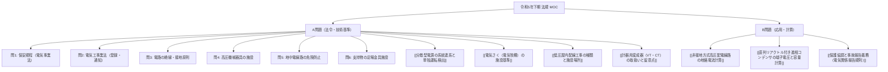

# 📜 電験三種 令和5年下期 法規 全問攻略（MOC）

『令和5年度下期 第三種電気主任技術者試験（法規科目）』の全出題（A問題 問1〜問10、B問題 問11〜問13）における関係法令、重要概念、および計算問題の詳細プロセスを網羅したまとめノート（Map of Content: MOC）です。

---

## 🗺️ 出題体系マップ

---

## 1. 📘 A問題：重要法令・技術基準の要点（問1〜問10）

### 【問1】自家用電気工作物の保安規程（電気事業法施行規則 第50条）
- **定めるべき基本項目**:
  - 業務を管理する者の **「職務及び組織」**
  - 従事者に対する **「保安教育」**
  - 保安のための **「巡視、点検」** 及び検査
  - 災害その他非常の場合に採るべき **「措置」**
  - 保安についての **「記録」**

### 【問2】電気工事業法（業務の適正化に関する法律）
- **登録電気工事業者**: 一般用電気工作物等の工事を行う者。経済産業大臣又は **都道府県知事** の登録を受ける。
- **通知電気工事業者**: 自家用電気工作物（$500\,\text{kW}$ 未満）のみの工事を行う者。経済産業大臣又は **産業保安監督部長（都道府県知事）** に通知を行う。

### 【問3】電路の絶縁の原則（電気設備技術基準 第5条）
- 電路は大地から **「絶縁」** しなければならない。
- **例外**: 混触による高電圧侵入や事故防止のための **「接地」** 等の措置を講じる場合は例外として認められる。

### 【問4】高圧機械器具の施設場所（電技解釈 第21条）
- 屋外・変電所以外の場所に高圧機器を施設する場合：
  - さく・へい等（充電部までの距離との和を $5\,\text{m}$ 以上）
  - 金属製の箱に収める場合は **A種接地工事** を施すこと（※「D種接地」とする記述は誤り！）。

### 【問5】地中電線等による工作物への危険防止（技術基準 第30条、解釈 第47条）
- 地中電線と弱電流電線等の交差・接近：故障時の **アーク放電** による損傷防止措置、または防火措置（耐火仕切壁等）。
- 地中電線路で作業員が立ち入るもの（暗きょ等）には **防火措置（換気設備）** を講じること。

### 【問6】架空電線路の支持物の足場金具（電技解釈 第53条）
- 地表面から **$1.8 \ \text{m}$ 未満** に施設できる例外：
  - 金具が内部に格納できる構造、昇塔防止装置、さく・へいの施設、山地等で人が容易に立ち入れない場所。
  - ※「監視装置を施設する場合」は昇塔防止の要件に該当しないため不可。

### 【問7】[[分散型電源の系統連系と単独運転検出]]（電技解釈 第220条）
- **単独運転**: 系統事故等で解列後も発電を継続し、線路負荷に給電している状態。
- **受動的方式**: 単独運転移行時の電圧位相・周波数の急変から検出。

### 【問8】[[電気さく（電気牧柵）の施設基準]]（技術基準 第74条、解釈 第192条）
- 田畑・牧場で害獣侵入・家畜脱出防止に限定。
- 使用電圧 **$30 \ \text{V}$ 以上** の電路から受電する場合、**定格感度電流 $15 \ \text{mA}$ 以下**、**動作時間 $0.1$ 秒以下** の漏電遮断器を施設すること。

### 【問9】[[低圧屋内配線工事の種類と施設場所]]（電技解釈 第165条）
- ライティングダクト工事：支持点間距離 **$2 \ \text{m}$ 以下**、開口部は下向き、造営材の貫通は不可。

### 【問10】[[計器用変成器（VT・CT）の取扱いと留意点]]
- **変流器（CT）の二次側開路厳禁**: 通電中に開路すると鉄心が飽和し、二次側に高電圧パルスが誘起されてコイル焼損や感電事故を引き起こす。電流計交換時はあらかじめ**二次端子を短絡片で短絡**すること。

---

## 2. 🔍 B問題：計算問題の完全解法プロセス（問11〜問13）

### 【問11】[[非接地方式高圧配電線路の地絡電流計算]]
- **(a) 一線完全地絡電流 $I_g$ の公式**:
  $$I_g = 2\sqrt{3}\pi f V (C_1 + C_2) \quad [\text{A}]$$
- **(b) 需要家構内の零相変流器（ZCT）で検出される電流 $I_{g2}$（もらい事故）**:
  $$I_{g2} = 2\sqrt{3}\pi f V C_2$$
  - 与条件：$V = 6600\,\text{V}$、 $f = 60\,\text{Hz}$、 $C_2 = 0.02\,\mu\text{F}$
  - 計算：$I_{g2} = 2\sqrt{3}\pi \times 60 \times 6600 \times (0.02 \times 10^{-6}) \approx \mathbf{86 \ \text{mA}}$

---

### 【問12】[[直列リアクトル付き進相コンデンサの端子電圧と容量計算]]
- **(a) $6\%$ 直列リアクトル挿入時のコンデンサ端子電圧 $V_C$**:
  $$V_C = \frac{X_C}{X_C - X_L} V = \frac{1}{1 - 0.06} \times 6600 = \frac{6600}{0.94} \approx \mathbf{7021 \ \text{V}}$$
- **(b) 目標力率（$0.6 \to 0.8$）達成のための三相コンデンサ容量 $Q_C$**:
  - 必要無効電力：
    $$\Delta Q = 300 \left(\frac{0.8}{0.6} - \frac{0.6}{0.8}\right) = 300 (1.333 - 0.75) = 175 \ \text{kvar}$$
  - 直列リアクトル付き設備全体の供給無効電力 $Q_{\text{total}} = 0.94 Q_C$ より：
    $$Q_C = \frac{175}{0.94} \approx \mathbf{186 \ \text{kvar}}$$

---

### 【問13】[[保護協調と事故報告義務（電気関係報告規則）]]
- **(a) 事故報告義務（報告規則第3条）**:
  - 自家用電気工作物の破損等により、**一般送配電事業者の電圧 $3000 \ \text{V}$ 以上の電路** に供給支障（事故点2または3）を生じさせた場合、産業保安監督部長へ報告義務がある。
- **(b) 保護協調（リレー協調）**:
  - 事故点直近の遮断器Bが上流の変電所遮断器Aより早く動作するよう、動作時間は **「曲線2」** および **「曲線4」**（動作時間が短い特性）を選択。
  - 地絡事故の構内・構外判定には **地絡方向継電器（DGR）** を使用する。

---

## 📚 参照資料
- 原本問題・解説PDF: [法規_模擬試験問題/R05(下期)法規.pdf](file:///c:/Users/kanat/OneDrive/新しいフォルダー/法規_模擬試験問題/R05(下期)法規.pdf)

---

## 関連ノート
- [[電験三種 頻出要点攻略 MOC]]
- [[高電圧実験 まとめMOC]]
- [[電気機器設計の予備知識（授業まとめMOC）]]
- [[AGENTS|SecondBrain運用ルール（AGENTS.md）]]
