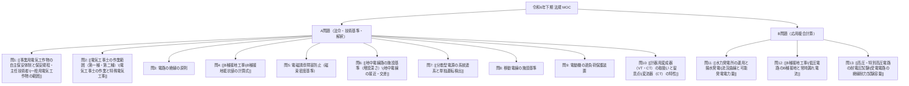

# 📜 電験三種 令和6年下期 法規 全問攻略（MOC）

令和6年度下期（R06下期）第三種電気主任技術者試験「法規科目」の全出題（A問題 問1〜問10、B問題 問11〜問13）における問題文・正解選択肢・関係法令・計算公式・詳細解法プロセスを網羅した完全攻略ノート（Map of Content: MOC）です。

原本PDF: `[[R06(下期)法規.pdf]]`

---

## 🗺️ 出題体系マップ

---

## 1. 📘 A問題：重要法令・技術基準の要点（問1〜問10）

### 【問1】一般用電気工作物の範囲（電気事業法 第38条、施行規則 第48条）
- **属性**: `subject: 法規` | `chapter: Ch.1 電気事業法` | `difficulty: ★★☆` | `importance: A`
- **問題概要**: 一般用電気工作物に該当するものを選ぶ（他から受電する小規模需要設備・発電設備）。
- **正解**: **(5)**
- **選択肢の正誤判定ポイント**:
  - (1)・(3) 受電電圧 $6.6 \ \text{kV}$（高圧）であるため**自家用電気工作物**（低圧受電が一般用の条件）。
  - (2) 非常用予備発電装置（内燃力）の出力が $15 \ \text{kW} \ge 10 \ \text{kW}$ であるため**自家用**（内燃力は $10 \ \text{kW}$ 未満が一般用）。
  - (4) 太陽電池 $7 \ \text{kW}$ ＋ 風力 $15 \ \text{kW}$ ＋ 受電 $30 \ \text{kW} = 52 \ \text{kW} \ge 50 \ \text{kW}$ のため**自家用**。
  - **(5) [正解]**: 受電電圧 $200 \ \text{V}$（低圧）、受電 $35 \ \text{kW}$、太陽電池 $5 \ \text{kW}$（$50 \ \text{kW}$ 未満の小規模発電設備）であり、合計 $40 \ \text{kW} < 50 \ \text{kW}$ であるため**一般用電気工作物に該当**する。
- **関連ノート**: [[事業用電気工作物の自主保安体制と保安規程・主任技術者]]

---

### 【問2】電気工事士の作業範囲と特種電気工事（電気工事士法 第3条、施行令 第2条の2）
- **属性**: `subject: 法規` | `chapter: Ch.3 電気工事士法` | `difficulty: ★★☆` | `importance: A`
- **正解**: **(3)**（不適切な記述）
- **ポイント**:
  - 非常用予備発電装置の発電機に係る電気工事は、自家用電気工作物の最大電力の大きさに関わらず、**「特種電気工事資格者（非常用予備発電装置工事）」**でなければ作業に従事できません。
  - 第一種電気工事士の免状のみではこの作業に従事できないため、(3)が誤りです。
- **関連ノート**: [[電気工事士の作業範囲（第一種・第二種）]]

---

### 【問3】電路の絶縁の原則（電気設備技術基準 第5条）
- **属性**: `subject: 法規` | `chapter: Ch.8 電技省令` | `difficulty: ★☆☆` | `importance: A`
- **正解**: **(3)**
- **穴埋め**:
  - (ア) **絶縁**
  - (イ) **混触**
  - (ウ) **接地**
- **条文要点**: 電路は大地から「絶縁」しなければならない。ただし、高低圧の「混触」による高電圧侵入防止のための「接地」工事等の保安上必要な措置を講ずる場合は例外。
- **関連ノート**: [[低圧電路の絶縁抵抗]], [[B種接地工事]]

---

### 【問4】B種接地工事の接地抵抗値計算（電技解釈 第17条）
- **属性**: `subject: 法規` | `chapter: Ch.9 電技解釈` | `difficulty: ★★☆` | `importance: A`
- **問題概要**: 公称電圧 $6600 \ \text{V}$、架空線路延長 $20 \ \text{km}$（ケーブル以外）、1秒以内自動遮断装置ありの変圧器B種接地抵抗値の上限値。
- **正解**: **(4) 300 $\Omega$**
- **計算プロセス**:
  1. 線路電圧 $V = 6.6 / 1.1 = 6 \ \text{kV}$。
  2. 1線地絡電流 $I_1$ の算定式：
     $$I_1 = 1 + \frac{\frac{V}{1.1} L - 100}{150} = 1 + \frac{6 \times 20 - 100}{150} = 1 + \frac{20}{150} \approx 1.133 \ \text{A} \to 2 \ \text{A} \quad (\text{1未満切り上げ})$$
  3. 1秒以内自動遮断装置がある場合のB種接地抵抗上限値：
     $$R_B = \frac{600}{I_1} = \frac{600}{2} = \mathbf{300 \ [\Omega]}$$
- **関連ノート**: [[B種接地工事]]

---

### 【問5】電磁誘導障害防止と磁界規制（電気設備技術基準 第27条の2）
- **属性**: `subject: 法規` | `chapter: Ch.8 電技省令` | `difficulty: ★★☆` | `importance: B`
- **正解**: **(5)**
- **穴埋め**:
  - (ア) **人**
  - (イ) **健康**
  - (ウ) **磁束密度**
  - (エ) **$200 \ \mu\text{T}$**（商用周波数における規制値）
- **条文要点**: 変電所等の施設から生じる電磁誘導作用が「人」の「健康」に影響を及ぼさないよう、空間の「磁束密度」の平均値が商用周波数において「$200 \ \mu\text{T}$」以下になるよう施設しなければならない。

---

### 【問6】地中電線と他の地中電線等との接近・交差（電技解釈 第125条）
- **属性**: `subject: 法規` | `chapter: Ch.9 電技解釈` | `difficulty: ★★☆` | `importance: A`
- **正解**: **(4)**（不適切な条件）
- **ポイント**: 高圧・特高地中電線が相互に接近・交差する場合、離隔距離 $0 \ \text{m}$ 以上（接触可）にできる例外要件は「自消性難燃性被覆」「不燃性管に収める」「耐火性の仕切壁」などです。「埋設標識を設ける」ことは事故防止表示であって、離隔距離緩和の要件ではありません。
- **関連ノート**: [[地中電線路の施設基準（埋設深さ）]]

---

### 【問7】分散型電源の系統連系と再閉路時の事故防止（電技解釈 第224条）
- **属性**: `subject: 法規` | `chapter: Ch.9 電技解釈` | `difficulty: ★★★` | `importance: B`
- **正解**: **(3)**
- **穴埋め**:
  - (ア) **線路無電圧確認装置**
  - (イ) **不足電力リレー**
  - (ウ) **単独運転検出装置**
  - (エ) **逆電力リレー**
- **関連ノート**: [[分散型電源の系統連系と単独運転検出]]

---

### 【問8】移動電線の施設（技術基準 第56条、解釈 第171条）
- **属性**: `subject: 法規` | `chapter: Ch.9 電技解釈` | `difficulty: ★★☆` | `importance: B`
- **正解**: **(4)**
- **穴埋め**: (ア) **火災**、(イ) **過電流**、(ウ) **ボルト締め**、(エ) **屋内**

---

### 【問9】電動機の過負荷保護装置の施設（電技解釈 第153条）
- **属性**: `subject: 法規` | `chapter: Ch.9 電技解釈` | `difficulty: ★★☆` | `importance: A`
- **正解**: **(3)**
- **穴埋め**:
  - (ア) **自動的に**
  - (イ) **取扱者**
  - (ウ) **過電流**
  - (エ) **配線用**
  - (オ) **$0.2 \ \text{kW}$**
- **重要基準**: 定格出力が **$0.2 \ \text{kW}$ 以下の電動機** は、過負荷保護装置の施設を省略できる。

---

### 【問10】計器用変成器（変流器: CT）の特性（電技解釈）
- **属性**: `subject: 法規` | `chapter: Ch.9 電技解釈` | `difficulty: ★☆☆` | `importance: A`
- **正解**: **(5)**（誤っている記述）
- **ポイント**: 変流器の変流比は巻数比（$N_1/N_2$）によって構造的に決まるものであり、二次側の負担（抵抗値）によって変化することはありません。
- **関連ノート**: [[計器用変成器（VT・CT）の取扱いと留意点]]

---

## 2. 🔍 B問題：計算問題の完全解法プロセス（問11〜問13）

### 【問11】水力発電所の流況曲線と年間可能発電電力量
- **属性**: `subject: 法規` | `chapter: Ch.10 施設管理` | `difficulty: ★★☆` | `importance: A` | `format: B問題`
- **与条件**:
  - 最大使用水量 $Q_{\text{max}} = 15 \ \text{m}^3/\text{s}$、有効落差 $H = 20 \ \text{m}$。
  - 水車効率 $\eta_t = 90\%$、発電機効率 $\eta_g = 95\%$。
  - 100日以上の流況曲線：$Q = -0.05 d + 25 \ [\text{m}^3/\text{s}]$。

#### (a) 溢水が発生する日数 $d$
- **正解**: **(3) 200 日**
- **解法**: 溢水（最大使用水量を超えて無効放流する）がなくなる境界は $Q = 15 \ \text{m}^3/\text{s}$：
  $$15 = -0.05 d + 25 \implies 0.05 d = 10 \implies \mathbf{d = 200 \ [\text{日}]}$$

#### (b) 年間可能発電電力量 $W \ [\text{GW}\cdot\text{h}]$
- **正解**: **(1) 19.3 GW・h**
- **解法**:
  1. **溢水期間（$0 \le d \le 200$ 日：200日間）**:
     常に最大水量 $15 \ \text{m}^3/\text{s}$ で発電：
     $$P_1 = 9.8 \times 15 \times 20 \times 0.90 \times 0.95 = 2,513.7 \ \text{kW}$$
     $$W_1 = P_1 \times (24 \times 200) = 2,513.7 \times 4,800 = 12.066 \times 10^6 \ \text{kW}\cdot\text{h} = 12.066 \ \text{GW}\cdot\text{h}$$
  2. **減水期間（$200 < d \le 365$ 日：165日間）**:
     365日目の流量 $Q_{365} = -0.05 \times 365 + 25 = 6.75 \ \text{m}^3/\text{s}$。
     直線変化するため平均流量 $Q_{\text{avg}} = \frac{15 + 6.75}{2} = 10.875 \ \text{m}^3/\text{s}$。
     $$W_2 = 9.8 \times 10.875 \times 20 \times 0.90 \times 0.95 \times (24 \times 165) \approx 7.217 \ \text{GW}\cdot\text{h}$$
  3. **年間合計電力量**:
     $$W = W_1 + W_2 = 12.066 + 7.217 = \mathbf{19.283 \ \text{GW}\cdot\text{h} \approx 19.3 \ \text{GW}\cdot\text{h}}$$
- **関連ノート**: [[水力発電所の運用と揚水発電]], [[理論水力]]

---

### 【問12】低圧電路のB種接地抵抗値と常時対地漏れ電流
- **属性**: `subject: 法規` | `chapter: Ch.10 施設管理` | `difficulty: ★★★` | `importance: A` | `format: B問題`
- **与条件**:
  - 三相3線式低圧電路 $V = 200 \ \text{V}$、$f = 50 \ \text{Hz}$、対地静電容量 1相当たり $C = 0.1 \ \mu\text{F}$。
  - 高圧側1線地絡電流 $I_1 = 5 \ \text{A}$、高低圧混触時の自動遮断時間 $1.3$ 秒（1秒超2秒以内）。

#### (a) 許容されるB種接地抵抗 $R_B$ の上限値
- **正解**: **(4) 60 $\Omega$**
- **解法**: 遮断時間が1秒超2秒以内のため分子は $300$：
  $$R_B = \frac{300}{I_1} = \frac{300}{5} = \mathbf{60 \ [\Omega]}$$

#### (b) 接地抵抗 $R_B = 10 \ \Omega$ のとき常時流れる電流 $I_B \ [\text{mA}]$
- **正解**: **(1) 11 mA**
- **解法**:
  B点（変圧器中性線側一端子接地）から大地を通じて流れる電流は、残り2相の対地静電容量（各相 $C$）の合成リアクタンスを介して流れます。
  低圧電路の対地合成容量は $2C = 0.2 \ \mu\text{F}$（または一括中性点換算 $3C$）。
  相電圧 $E = \frac{V}{\sqrt{3}} = \frac{200}{\sqrt{3}} \approx 115.47 \ \text{V}$。
  対地容量性リアクタンス $X_C = \frac{1}{6\pi f C} = \frac{1}{6\pi \times 50 \times 0.1 \times 10^{-6}} \approx 10,610 \ \Omega$。
  $$I_B = \frac{E}{\sqrt{R_B^2 + X_C^2}} \approx \frac{115.47}{10,610} \approx 0.01088 \ \text{A} = \mathbf{10.9 \ \text{mA} \approx 11 \ \text{mA}}$$
- **関連ノート**: [[B種接地工事]]

---

### 【問13】受電電路の交流絶縁耐力試験（耐電圧試験）
- **属性**: `subject: 法規` | `chapter: Ch.10 施設管理` | `difficulty: ★★☆` | `importance: A` | `format: B問題`
- **与条件**:
  - 受電電圧 $6 \ \text{kV}$、契約電力 $500 \ \text{kW}$、周波数 $f = 50 \ \text{Hz}$。
  - 最大使用電圧 $V_m = 6,900 \ \text{V}$、3線一括対地静電容量 $C = 0.2 \ \mu\text{F}$。

#### (a) 試験時における対地充電電流 $I_c \ [\text{A}]$
- **正解**: **(4) 0.65 A**
- **解法**:
  1. $7,000 \ \text{V}$ 以下の高圧電路の試験電圧は最大使用電圧の **1.5倍**：
     $$V_t = 6,900 \times 1.5 = 10,350 \ \text{V}$$
  2. 3線一括の充電電流 $I_c$：
     $$I_c = 2\pi f C V_t = 2\pi \times 50 \times (0.2 \times 10^{-6}) \times 10,350 = 0.6503 \ \text{A} \approx \mathbf{0.65 \ [A]}$$

#### (b) 試験装置に必要な最小容量 $P_t \ [\text{kV}\cdot\text{A}]$
- **正解**: **(3) 7 kV・A**
- **解法**:
  $$P_t = V_t I_c = 10,350 \times 0.6503 = 6,730.6 \ \text{V}\cdot\text{A} = 6.73 \ \text{kV}\cdot\text{A} \implies \mathbf{7 \ [\text{kV}\cdot\text{A}]}$$
- **関連ノート**: [[高圧・特別高圧電路の耐電圧試験]]

---

## 関連ノート
- [[電験三種 法規科目 過去問攻略MOC]]
- [[電験三種 令和5年下期 法規 全問攻略MOC]]
- [[電験三種 頻出要点攻略 MOC]]
- [[PDF全文テキスト化・属性別知識構造化によるSecondBrain進化企画書]]
