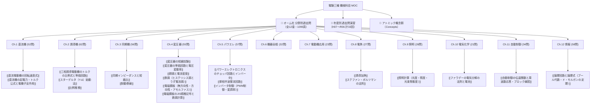

# ⚙️ 電験三種 機械科目 過去問完全攻略（MOC）

電験三種「機械科目」の合格を盤石にするための総合ハブノートです。
本書では、**オーム社「分野別過去問題集（過去31年分・1095ページ）」**の単元構成（タテ糸）と、**平成7年度（H07）から令和6年度（R06）までの年度別過去問演習（ヨコ糸）**を、アトミックな概念ノート（[[Concepts]]）と完全相互リンクで統合しています。

---

## 🗺️ 機械科目 知識体系マップ

---

## 📕 オーム社 分野別過去問題集（過去31年分）単元別インデックス

PDF原本（`SecondBrain/Docs/分野別過去問_オーム社/`）の各章へ1クリックでジャンプできます。

| 章 | 単元名 | 収録問数 | 原本該当ページ | 主な重要概念・公式リンク |
| :---: | :--- | :---: | :---: | :--- |
| **Ch.1** | [[電験3種_機械_分野別過去問題集_過去31年分_オーム社_全ページ.pdf#page=6\|直流機]] | 52問 | P.6 〜 105 | [[直流電動機の回転速度式]], [[直流機の起電力・トルク公式と電機子反作用]] |
| **Ch.2** | [[電験3種_機械_分野別過去問題集_過去31年分_オーム社_全ページ.pdf#page=106\|誘導機]] | 62問 | P.106 〜 227 | [[三相誘導電動機のトルクの比例式と等価回路]], [[スターデルタ（Y-Δ）始動法]], [[比例推移]] |
| **Ch.3** | [[電験3種_機械_分野別過去問題集_過去31年分_オーム社_全ページ.pdf#page=228\|同期機]] | 56問 | P.228 〜 337 | [[同期インピーダンスと短絡比]], [[制動巻線]], [[送電線のフェランチ効果と自己励磁現象]] |
| **Ch.4** | [[電験3種_機械_分野別過去問題集_過去31年分_オーム社_全ページ.pdf#page=338\|変圧器]] | 55問 | P.338 〜 445 | [[変圧器の短絡試験]], [[変圧器の等価回路と電圧変動率]], [[銅損と電流密度]], [[鉄損（ヒステリシス損とうず電流損）]], [[電磁鋼板（無方向性・方向性・アモルファス）]], [[電磁鋼板のJIS規格記号と鉄損計算]] |
| **Ch.5** | [[電験3種_機械_分野別過去問題集_過去31年分_オーム社_全ページ.pdf#page=446\|パワーエレクトロニクス]] | 57問 | P.446 〜 599 | [[パワーエレクトロニクスのチョッパ回路とインバータ]], [[単相半波整流回路]], [[インバータ制御（PWM制御・変調率）]] |
| **Ch.6** | [[電験3種_機械_分野別過去問題集_過去31年分_オーム社_全ページ.pdf#page=600\|機器全般]] | 32問 | P.600 〜 663 | 絶縁階級、保護構造、変圧器の並行運転条件 |
| **Ch.7** | [[電験3種_機械_分野別過去問題集_過去31年分_オーム社_全ページ.pdf#page=664\|電動機応用]] | 23問 | P.664 〜 707 | 負荷トルク特性、GD2・慣性モーメント計算、巻上機動力 |
| **Ch.8** | [[電験3種_機械_分野別過去問題集_過去31年分_オーム社_全ページ.pdf#page=708\|電熱（電気加熱）]] | 27問 | P.708 〜 761 | [[誘導加熱]], [[ステファン・ボルツマンの法則]], 誘電加熱・アーク加熱 |
| **Ch.9** | [[電験3種_機械_分野別過去問題集_過去31年分_オーム社_全ページ.pdf#page=762\|照明]] | 26問 | P.762 〜 813 | [[照明計算（光度・照度・光束発散度）]], 点光源・配光曲線・光束法 |
| **Ch.10** | [[電験3種_機械_分野別過去問題集_過去31年分_オーム社_全ページ.pdf#page=814\|電気化学]] | 21問 | P.814 〜 853 | [[ファラデーの電気分解の法則と電池]], 鉛蓄電池・リチウムイオン電池 |
| **Ch.11** | [[電験3種_機械_分野別過去問題集_過去31年分_オーム社_全ページ.pdf#page=854\|自動制御]] | 34問 | P.854 〜 933 | [[自動制御の伝達関数と周波数応答・ブロック線図]], ボード線図・安定判別 |
| **Ch.12** | [[電験3種_機械_分野別過去問題集_過去31年分_オーム社_全ページ.pdf#page=934\|情報]] | 58問 | P.934 〜 1095 | [[論理回路と論理式（ブール代数・ド・モルガンの定理）]], 2進数・AD変換・フローチャート |

---

## 2. ⚡ 分野別・重要出題論点と解法エッセンス

### ① 4大電気機器（直流・誘導・同期・変圧器）
- **直流機**:
  - 速度式 $N = \frac{V - I_a R_a}{k \Phi}$。界磁磁束 $\Phi$ 減で増速、電機子電圧制御で広範囲変速。
  - トルク式 $T = k' \Phi I_a$。直巻電動機は $T \propto I_a^2$（トルク特性急峻、軽負荷時危険速度）。
- **誘導機**:
  - パワーフロー比率 $P_2 : P_{c2} : P_m = 1 : s : (1-s)$。二次銅損 $P_{c2} = s P_2$。
  - [[スターデルタ（Y-Δ）始動法]]で始動電流・トルクともに $1/3$。
  - 巻線形は[[比例推移]]により二次挿入抵抗 $R_2$ に比例して最大トルクすべり $s_m$ がシフト（最大トルク不変）。
- **同期機**:
  - 同期インピーダンス $Z_s$ と短絡比 $K_s = 1/\%Z_s$。鉄機械は $K_s$ 大・電圧変動率小・安定度大。
  - V曲線（位相特性）：界磁電流増加で進み無効電力（進相コンデンサ動作）。
- **変圧器**:
  - [[変圧器の短絡試験]]でインピーダンス電圧・全負荷銅損 $P_n$ 算出。無負荷試験で励磁電流・鉄損 $P_i$ 算出。
  - 最大効率条件は **鉄損＝銅損（$P_i = m^2 P_c$）**。

### ② パワーエレクトロニクス
- 降圧チョッパ：$V_o = \alpha V_i$、昇圧チョッパ：$V_o = \frac{1}{1-\alpha} V_i$。
- [[インバータ制御（PWM制御・変調率）]]：変調率 $M = E_s / E_c$ により出力基本波電圧実効値 $V_{L1} = \frac{\sqrt{3} M E_d}{2\sqrt{2}}$。

### ③ 電気応用・制御・情報
- 電熱：放射熱流束 $J = \sigma T^4$（[[ステファン・ボルツマンの法則]]）。誘導加熱は表皮深さ $\delta = \sqrt{2/(\omega \mu \sigma)}$。
- 照明：法線照度 $E_n = I/r^2$、水平面照度 $E_h = \frac{I \cos^3\theta}{h^2}$。光束法 $F = \frac{E A D}{N U}$。
- 電気化学：析出量 $W = \frac{M}{z F} I t$（[[ファラデーの電気分解の法則と電池]]）。
- 制御：閉ループ $W(s) = \frac{G(s)}{1 + G(s)H(s)}$。ボード線図で利得余裕・位相余裕。
- 情報：[[論理回路と論理式（ブール代数・ド・モルガンの定理）]]。$\overline{A+B} = \overline{A}\cdot\overline{B}$、$\overline{A\cdot B} = \overline{A}+\overline{B}$。

---

## 📝 年度別過去問・模擬試験演習トラッカー（H07〜R06）

`SecondBrain/Docs/年度別過去問/機械/` に格納されているPDF原本にリンクしています。

| 年度・回別 | 原本PDFリンク | 演習状況 | 得点 / 判定 | 復習フラグ | 備考・弱点単元 |
| :---: | :--- | :---: | :---: | :---: | :--- |
| **R06 上期** | [[令和6年上期　機械.pdf\|R06上期 機械]] | [ ] | / 100 | - | 最新本試験問題 |
| **R05 下期** | [[R05(下期)機械.pdf\|R05下期 機械]] | [ ] | / 100 | - | |
| **R05 上期** | [[令和5年上期　機械.pdf\|R05上期 機械]] | [ ] | / 100 | - | |
| **R04 下期** | [[R04(下期)機械.pdf\|R04下期 機械]] | [ ] | / 100 | - | |
| **R03** | [[R03機械.pdf\|R03 機械]] | [ ] | / 100 | - | |
| **R02** | [[R02機械.pdf\|R02 機械]] | [ ] | / 100 | - | |
| **R01** | [[R01機械.pdf\|R01 機械]] | [ ] | / 100 | - | 令和元年（H31） |
| **H30** | [[H30機械.pdf\|H30 機械]] | [ ] | / 100 | - | |
| **H29** | [[H29機械.pdf\|H29 機械]] | [ ] | / 100 | - | |
| **H28** | [[H28機械.pdf\|H28 機械]] | [ ] | / 100 | - | |
| **H27** | [[H27機械.pdf\|H27 機械]] | [ ] | / 100 | - | |
| **H26** | [[H26機械.pdf\|H26 機械]] | [ ] | / 100 | - | |
| **H25** | [[H25機械.pdf\|H25 機械]] | [ ] | / 100 | - | |
| **H24** | [[H24機械.pdf\|H24 機械]] | [ ] | / 100 | - | |
| **H23** | [[H23機械.pdf\|H23 機械]] | [ ] | / 100 | - | |
| **H22** | [[H22機械.pdf\|H22 機械]] | [ ] | / 100 | - | |
| **H21** | [[H21機械.pdf\|H21 機械]] | [ ] | / 100 | - | |
| **H20** | [[H20機械.pdf\|H20 機械]] | [ ] | / 100 | - | |
| **H19** | [[H19機械.pdf\|H19 機械]] | [ ] | / 100 | - | |
| **H18** | [[H18機械.pdf\|H18 機械]] | [ ] | / 100 | - | |
| **H17** | [[H17機械.pdf\|H17 機械]] | [ ] | / 100 | - | |
| **H16** | [[H16機械.pdf\|H16 機械]] | [ ] | / 100 | - | |
| **H15** | [[H15機械.pdf\|H15 機械]] | [ ] | / 100 | - | |
| **H14** | [[H14機械.pdf\|H14 機械]] | [ ] | / 100 | - | |
| **H13** | [[H13機械.pdf\|H13 機械]] | [ ] | / 100 | - | |
| **H12** | [[H12機械.pdf\|H12 機械]] | [ ] | / 100 | - | |
| **H11** | [[H11機械.pdf\|H11 機械]] | [ ] | / 100 | - | |
| **H10** | [[H10機械.pdf\|H10 機械]] | [ ] | / 100 | - | |
| **H09** | [[H09機械.pdf\|H09 機械]] | [ ] | / 100 | - | |
| **H08** | [[H08機械.pdf\|H08 機械]] | [ ] | / 100 | - | |
| **H07** | [[H07機械.pdf\|H07 機械]] | [ ] | / 100 | - | |

---

## 関連ノート
- [[電験三種 頻出要点攻略 MOC]]
- [[電験三種 電力科目 過去問攻略MOC]]
- [[電験三種 法規科目 過去問攻略MOC]]
- [[電験三種・全教材Obsidian統合プロジェクト企画書]]
- [[電気機器設計の予備知識（授業まとめMOC）]]
- [[AGENTS|SecondBrain運用ルール（AGENTS.md）]]
