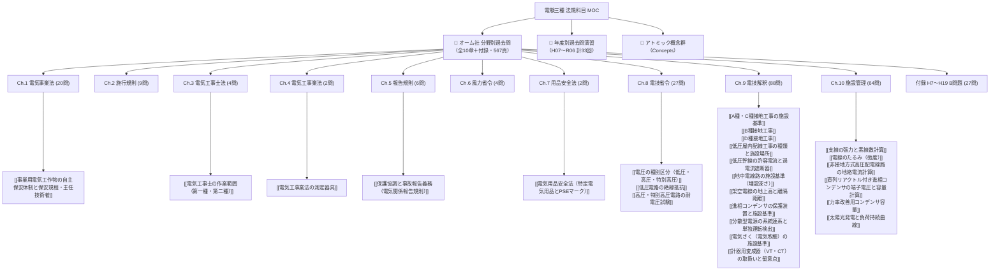

# 📜 電験三種 法規科目 過去問完全攻略（MOC）

電験三種「法規科目」の合格を盤石にするための総合ハブノートです。
本書では、**オーム社「分野別過去問題集（過去18年分・567ページ）」**の条文・省令・計算単元構成（タテ糸）と、**平成7年度（H07）から令和6年度（R06）までの年度別過去問演習（ヨコ糸）**を、アトミックな概念ノート（[[Concepts]]）と完全相互リンクで統合しています。

---

## 🗺️ 法規科目 知識体系マップ

---

## 📕 オーム社 分野別過去問題集（過去18年分）単元別インデックス

PDF原本（`SecondBrain/Docs/分野別過去問_オーム社/`）の各章へ1クリックでジャンプできます。

| 章 | 単元名 | 収録問数 | 原本該当ページ | 主な重要概念・条文リンク |
| :---: | :--- | :---: | :---: | :--- |
| **Ch.1** | [[電験3種_法規_分野別過去問題集_過去18年分_オーム社.pdf#page=6\|電気事業法]] | 20問 | P.6 〜 47 | [[事業用電気工作物の自主保安体制と保安規程・主任技術者]], 工作物の定義区分, 適合維持義務 |
| **Ch.2** | [[電験3種_法規_分野別過去問題集_過去18年分_オーム社.pdf#page=48\|電気事業法施行規則]] | 9問 | P.48 〜 65 | [[事業用電気工作物の自主保安体制と保安規程・主任技術者]], 保安規程の記載細目, 使用前自主検査 |
| **Ch.3** | [[電験3種_法規_分野別過去問題集_過去18年分_オーム社.pdf#page=66\|電気工事士法]] | 4問 | P.66 〜 73 | [[電気工事士の作業範囲（第一種・第二種）]], 簡易電気工事, 軽微な作業（資格不要） |
| **Ch.4** | [[電験3種_法規_分野別過去問題集_過去18年分_オーム社.pdf#page=74\|電気工事業の業務の適正化に関する法律]] | 2問 | P.74 〜 77 | [[電気工事業法の測定器具]], 登録電気工事業者・通知電気工事業者の区分 |
| **Ch.5** | [[電験3種_法規_分野別過去問題集_過去18年分_オーム社.pdf#page=78\|電気関係報告規則]] | 6問 | P.78 〜 89 | [[保護協調と事故報告義務（電気関係報告規則）]], 3000V以上工作物の事故報告, 感電死傷事故 |
| **Ch.6** | [[電験3種_法規_分野別過去問題集_過去18年分_オーム社.pdf#page=90\|発電用風力設備に関する技術基準を定める省令]] | 4問 | P.90 〜 97 | 風車設備の安全率, 過回転防止装置, 倒壊防止措置 |
| **Ch.7** | [[電験3種_法規_分野別過去問題集_過去18年分_オーム社.pdf#page=98\|電気用品安全法]] | 2問 | P.98 〜 101 | [[電気用品安全法（特定電気用品とPSEマーク）]], 菱形・丸形PSEの区分, 自主検査と適合性検査 |
| **Ch.8** | [[電験3種_法規_分野別過去問題集_過去18年分_オーム社.pdf#page=102\|電気設備に関する技術基準を定める省令]] | 27問 | P.102 〜 155 | [[電圧の種別区分（低圧・高圧・特別高圧）]], [[低圧電路の絶縁抵抗]], [[高圧・特別高圧電路の耐電圧試験]] |
| **Ch.9** | [[電験3種_法規_分野別過去問題集_過去18年分_オーム社.pdf#page=156\|電気設備の技術基準の解釈]] | 88問 | P.156 〜 351 | [[A種・C種接地工事の施設基準]], [[B種接地工事]], [[D種接地工事]], [[低圧屋内配線工事の種類と施設場所]], [[低圧幹線の許容電流と過電流遮断器]], [[地中電線路の施設基準（埋設深さ）]], [[架空電線の地上高と離隔距離]], [[進相コンデンサの保護装置と施設基準]], [[分散型電源の系統連系と単独運転検出]] |
| **Ch.10** | [[電験3種_法規_分野別過去問題集_過去18年分_オーム社.pdf#page=352\|電気施設管理（計算・B問題）]] | 64問 | P.352 〜 529 | [[支線の張力と素線数計算]], [[電線のたるみ（弛度）]], [[非接地方式高圧配電線路の地絡電流計算]], [[直列リアクトル付き進相コンデンサの端子電圧と容量計算]], [[力率改善用コンデンサ容量]], [[太陽光発電と負荷持続曲線]] |
| **付録** | [[電験3種_法規_分野別過去問題集_過去18年分_オーム社.pdf#page=530\|1995〜2007 (H7〜H19) 年度 B問題]] | 27問 | P.530 〜 567 | 過去の出題遺産から学ぶB問題応用計算演習 |

---

## 2. ⚡ 分野別・重要出題論点と解法エッセンス

### ① 電気関係法規（法律・省令・規則）
- **電気事業法**:
  - [[事業用電気工作物の自主保安体制と保安規程・主任技術者]]。
  - 保安規程の届出義務、主任技術者の監督範囲（第1種:無制限、第2種:17万V未満、第3種:5万V未満）。
- **電気工事士法**:
  - [[電気工事士の作業範囲（第一種・第二種）]]。第1種（一般用＋500kW未満自家用）、第2種（一般用のみ）、認定電気工事従事者（500kW未満自家用の簡易低圧工事）。
- **用品安全法・工事業法・報告規則**:
  - [[電気用品安全法（特定電気用品とPSEマーク）]]：特定電気用品（菱形PSE・116品目・適合性検査義務）とその他（丸形PSE・341品目）。
  - [[電気工事業法の測定器具]]：絶縁抵抗計、接地抵抗計、回路計の3点義務。
  - [[保護協調と事故報告義務（電気関係報告規則）]]：3,000V以上工作物の波及事故。

### ② 技術基準・解釈（A問題対策）
- **電圧・絶縁・耐電圧**:
  - [[電圧の種別区分（低圧・高圧・特別高圧）]]：低圧（AC 600V以下 / DC 750V以下）、高圧（7,000V以下）、特高（7,000V超）。
  - [[低圧電路の絶縁抵抗]]：対地電圧150V以下（$0.1\,\text{M}\Omega$）、300V以下（$0.2\,\text{M}\Omega$）、300V超（$0.4\,\text{M}\Omega$）。
  - [[高圧・特別高圧電路の耐電圧試験]]：最大使用電圧の $1.5$ 倍（交流10分間）、直流試験時は交流の **2倍**。
- **接地工事4種**:
  - [[A種・C種接地工事の施設基準]]：A種（高圧・特高用外箱、$10\,\Omega$）、C種（300V超低圧、$10\,\Omega$ / 0.5秒遮断時 $500\,\Omega$）。
  - [[B種接地工事]]：変圧器低圧側電路（$150/I_1$、0.5〜2秒遮断時 $300/I_1$、1秒遮断時 $600/I_1$）。
  - [[D種接地工事]]：300V以下低圧（$100\,\Omega$ / 0.5秒遮断時 $500\,\Omega$）。

### ③ 施設管理・B問題計算（合否を分ける最重要分野）
1. [[支線の張力と素線数計算]]: 水平力合成 $\to$ モーメントつり合い $\to$ 斜め張力 $\to$ 安全率1.5以上と素線数切り上げ。
2. [[電線のたるみ（弛度）]]: $D = \frac{W S^2}{8 T}$。自重＋風圧荷重（甲種・乙種・丙種）のベクトル合成。
3. [[非接地方式高圧配電線路の地絡電流計算]]: $I_g = 2\sqrt{3}\pi f V (C_1 + C_2)$。ZCTによる零相電流検出。
4. [[直列リアクトル付き進相コンデンサの端子電圧と容量計算]]: 6%リアクトル挿入による端子電圧上昇（$1.064$ 倍）と所要設備容量（$\Delta Q / 0.94$）。
5. [[力率改善用コンデンサ容量]]: $\Delta Q = P (\tan\theta_1 - \tan\theta_2)$。変圧器過負荷解消計算。

---

## 📝 年度別過去問・模擬試験演習トラッカー（H07〜R06）

`SecondBrain/Docs/年度別過去問/法規/` に格納されているPDF原本にリンクしています。

| 年度・回別 | 原本PDFリンク | 演習状況 | 得点 / 判定 | 復習フラグ | 備考・弱点単元 |
| :---: | :--- | :---: | :---: | :---: | :--- |
| **R06 下期** | [[R06(下期)法規.pdf\|R06下期 法規]] | [ ] | / 100 | - | 詳細解説: [[電験三種 令和6年下期 法規 全問攻略MOC]] |
| **R06 上期** | [[R06(上期)法規.pdf\|R06上期 法規]] | [ ] | / 100 | - | |
| **R05 下期** | [[R05(下期)法規.pdf\|R05下期 法規]] | [ ] | / 100 | - | 詳細解説: [[電験三種 令和5年下期 法規 全問攻略MOC]] |
| **R05 上期** | [[R05(上期)法規.pdf\|R05上期 法規]] | [ ] | / 100 | - | |
| **R04 下期** | [[R04(下期)法規.pdf\|R04下期 法規]] | [ ] | / 100 | - | |
| **R04 上期** | [[R04(上期)法規.pdf\|R04上期 法規]] | [ ] | / 100 | - | |
| **R03** | [[R03法規.pdf\|R03 法規]] | [ ] | / 100 | - | |
| **R02** | [[R02法規.pdf\|R02 法規]] | [ ] | / 100 | - | |
| **R01** | [[R01法規.pdf\|R01 法規]] | [ ] | / 100 | - | 令和元年（H31） |
| **H30** | [[H30法規.pdf\|H30 法規]] | [ ] | / 100 | - | |
| **H29** | [[H29法規.pdf\|H29 法規]] | [ ] | / 100 | - | |
| **H28** | [[H28法規.pdf\|H28 法規]] | [ ] | / 100 | - | |
| **H27** | [[H27法規.pdf\|H27 法規]] | [ ] | / 100 | - | |
| **H26** | [[H26法規.pdf\|H26 法規]] | [ ] | / 100 | - | |
| **H25** | [[H25法規.pdf\|H25 法規]] | [ ] | / 100 | - | |
| **H24** | [[H24法規.pdf\|H24 法規]] | [ ] | / 100 | - | |
| **H23** | [[H23法規.pdf\|H23 法規]] | [ ] | / 100 | - | |
| **H22** | [[H22法規.pdf\|H22 法規]] | [ ] | / 100 | - | |
| **H21** | [[H21法規.pdf\|H21 法規]] | [ ] | / 100 | - | |
| **H20** | [[H20法規.pdf\|H20 法規]] | [ ] | / 100 | - | |
| **H19** | [[H19法規.pdf\|H19 法規]] | [ ] | / 100 | - | |
| **H18** | [[H18法規.pdf\|H18 法規]] | [ ] | / 100 | - | |
| **H17** | [[H17法規.pdf\|H17 法規]] | [ ] | / 100 | - | |
| **H16** | [[H16法規.pdf\|H16 法規]] | [ ] | / 100 | - | |
| **H15** | [[H15法規.pdf\|H15 法規]] | [ ] | / 100 | - | |
| **H14** | [[H14法規.pdf\|H14 法規]] | [ ] | / 100 | - | |
| **H13** | [[H13法規.pdf\|H13 法規]] | [ ] | / 100 | - | |
| **H12** | [[H12法規.pdf\|H12 法規]] | [ ] | / 100 | - | |
| **H11** | [[H11法規.pdf\|H11 法規]] | [ ] | / 100 | - | |
| **H10** | [[H10法規.pdf\|H10 法規]] | [ ] | / 100 | - | |
| **H09** | [[H09法規.pdf\|H09 法規]] | [ ] | / 100 | - | |
| **H08** | [[H08法規.pdf\|H08 法規]] | [ ] | / 100 | - | |
| **H07** | [[H07法規.pdf\|H07 法規]] | [ ] | / 100 | - | |

---

## 関連ノート
- [[電験三種 頻出要点攻略 MOC]]
- [[電験三種 令和5年下期 法規 全問攻略MOC]]
- [[電験三種 電力科目 過去問攻略MOC]]
- [[電験三種 機械科目 過去問攻略MOC]]
- [[電験三種・全教材Obsidian統合プロジェクト企画書]]
- [[AGENTS|SecondBrain運用ルール（AGENTS.md）]]
