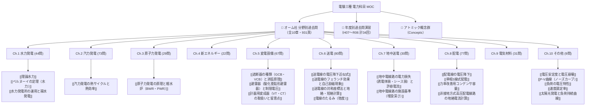

# ⚡ 電験三種 電力科目 過去問完全攻略（MOC）

電験三種「電力科目」の合格を盤石にするための総合ハブノートです。
本書では、**オーム社「分野別過去問題集（過去31年分・931ページ）」**の単元構成（タテ糸）と、**平成7年度（H07）から令和6年度（R06）までの年度別過去問演習（ヨコ糸）**を、アトミックな概念ノート（[[Concepts]]）と完全相互リンクで統合しています。

---

## 🗺️ 電力科目 知識体系マップ

---

## 📕 オーム社 分野別過去問題集（過去31年分）単元別インデックス

PDF原本（`SecondBrain/Docs/分野別過去問_オーム社/`）の各章へ1クリックでジャンプできます。

| 章 | 単元名 | 収録問数 | 原本該当ページ | 主な重要概念・公式リンク |
| :---: | :--- | :---: | :---: | :--- |
| **Ch.1** | [[電験3種_電力_分野別過去問題集_過去31年分_オーム社.pdf#page=6\|水力発電]] | 44問 | P.6 〜 91 | [[理論水力]], [[ベルヌーイの定理（水力）]], [[水力発電所の運用と揚水発電]] |
| **Ch.2** | [[電験3種_電力_分野別過去問題集_過去31年分_オーム社.pdf#page=92\|汽力発電]] | 73問 | P.92 〜 239 | [[汽力発電の熱サイクルと熱効率]], ランキンサイクル・再生・再熱 |
| **Ch.3** | [[電験3種_電力_分野別過去問題集_過去31年分_オーム社.pdf#page=240\|原子力発電]] | 29問 | P.240 〜 295 | [[原子力発電の原理と軽水炉（BWR・PWR）]], ウラン濃縮・制御棒・自己制御性 |
| **Ch.4** | [[電験3種_電力_分野別過去問題集_過去31年分_オーム社.pdf#page=296\|新エネルギー]] | 22問 | P.296 〜 339 | 太陽光発電、風力発電（ベッツの法則）、燃料電池、バイオマス |
| **Ch.5** | [[電験3種_電力_分野別過去問題集_過去31年分_オーム社.pdf#page=340\|変電設備]] | 67問 | P.340 〜 473 | [[遮断器の種類（GCB・VCB）と消弧原理]], [[避雷器（酸化亜鉛形避雷器）と制限電圧]], [[計器用変成器（VT・CT）の取扱いと留意点]] |
| **Ch.6** | [[電験3種_電力_分野別過去問題集_過去31年分_オーム社.pdf#page=474\|送電]] | 80問 | P.474 〜 631 | [[送電線の電圧降下近似式]], [[送電線のフェランチ効果と自己励磁現象]], [[送電線の対称座標法と地絡・短絡計算]], [[電線のたるみ（弛度）]] |
| **Ch.7** | [[電験3種_電力_分野別過去問題集_過去31年分_オーム社.pdf#page=632\|地中送電]] | 30問 | P.632 〜 693 | [[地中電線路の電力損失（誘電体損・シース損）と許容電流]], [[地中電線路の施設基準（埋設深さ）]] |
| **Ch.8** | [[電験3種_電力_分野別過去問題集_過去31年分_オーム社.pdf#page=694\|配電]] | 77問 | P.694 〜 847 | [[配電線の電圧降下]], [[単相3線式配電]], [[力率改善用コンデンサ容量]], [[非接地方式高圧配電線路の地絡電流計算]] |
| **Ch.9** | [[電験3種_電力_分野別過去問題集_過去31年分_オーム社.pdf#page=848\|電気材料]] | 31問 | P.848 〜 907 | 絶縁油、架橋ポリエチレン、SF6ガス、磁性材料・導電材料 |
| **Ch.10** | [[電験3種_電力_分野別過去問題集_過去31年分_オーム社.pdf#page=908\|その他（電力系統・需給制御）]] | 9問 | P.908 〜 931 | [[電圧安定度と電圧崩壊]], [[P-V曲線（ノーズカーブ）]], [[負荷の電圧特性]], [[速度調定率]], [[太陽光発電と負荷持続曲線]] |

---

## 2. ⚡ 分野別・重要出題論点と解法エッセンス

### ① 発電工学（水力・火力・原子力・新エネ）
- **水力発電**:
  - 理論水力 $P = 9.8 Q H \ [\text{kW}]$、発電端出力 $P = 9.8 Q H \eta$。
  - ベルヌーイの定理（位置水頭＋圧力水頭＋速度水頭＝一定）。
  - 流況曲線（豊水95日、平水185日、低水275日、渇水355日）と揚水発電総合効率（$70 \sim 75\%$）。
- **火力発電**:
  - 熱効率 $\eta = \frac{3600 W}{B H} \times 100 \ [\%]$。
  - コンバインドサイクル発電（ガスタービン＋排熱回収ボイラ＋蒸気タービン、熱効率 $55 \sim 60\%$ 超）。
- **原子力発電**:
  - [[原子力発電の原理と軽水炉（BWR・PWR）]]。BWR（1系統・直サイクル・下部制御棒）、PWR（2系統・間接サイクル・蒸気発生器・上部制御棒）。

### ② 送電・変電・地中送電
- **送電線路**:
  - 三相線間電圧降下近似式 $v = \frac{r P + x Q}{V_r} \ [\text{V}]$。
  - [[電線のたるみ（弛度）]] $D = \frac{W S^2}{8 T}$、電線実長 $L \approx S + \frac{8 D^2}{3 S}$。
  - [[送電線のフェランチ効果と自己励磁現象]]：軽負荷時の進み電流による受電端電圧上昇 $\to$ 分路リアクトル投入。
- **変電設備**:
  - [[遮断器の種類（GCB・VCB）と消弧原理]]：$\text{SF}_6$ ガスの優れた消弧能（空気の100倍）、真空中の高絶縁耐力。
  - [[避雷器（酸化亜鉛形避雷器）と制限電圧]]：$\text{ZnO}$ 素子の非直線抵抗特性、ギャップレス、続流阻止。
- **地中送電**:
  - [[地中電線路の電力損失（誘電体損・シース損）と許容電流]]：誘電体損 $W_d = 2\pi f C V^2 \tan\delta$、クロスボンド接地。

### ③ 配電・電力系統
- **配電線路**:
  - 電圧降下：単相2線式 $\Delta V = 2 I (r\cos\theta+x\sin\theta)$、三相3線式 $\Delta V = \sqrt{3} I (r\cos\theta+x\sin\theta)$。
  - [[単相3線式配電]]：中性線断線による軽負荷側異常過電圧とバランサ。
- **系統安定度・需給制御**:
  - [[電圧安定度と電圧崩壊]]・[[P-V曲線（ノーズカーブ）]]：潮流限界と無効電力補償。
  - [[速度調定率]] $R = \frac{\Delta f / f_n}{\Delta P / P_n} \times 100 \ [\%]$ によるガバナ負荷分担。

---

## 📝 年度別過去問・模擬試験演習トラッカー（H07〜R06）

`SecondBrain/Docs/年度別過去問/電力/` に格納されているPDF原本にリンクしています。

| 年度・回別 | 原本PDFリンク | 演習状況 | 得点 / 判定 | 復習フラグ | 備考・弱点単元 |
| :---: | :--- | :---: | :---: | :---: | :--- |
| **R06 下期** | [[令和6年下期　電力.pdf\|R06下期 電力]] | [ ] | / 100 | - | 最新本試験問題 |
| **R06 上期** | [[令和6年上期　電力.pdf\|R06上期 電力]] | [ ] | / 100 | - | |
| **R05 下期** | [[令和5年下期　電力.pdf\|R05下期 電力]] | [ ] | / 100 | - | |
| **R05 上期** | [[令和5年上期　電力.pdf\|R05上期 電力]] | [ ] | / 100 | - | |
| **R04 下期** | [[R04(下期)電力.pdf\|R04下期 電力]] | [ ] | / 100 | - | |
| **R04 上期** | [[R04(上期)電力.pdf\|R04上期 電力]] | [ ] | / 100 | - | |
| **R03** | [[R03電力.pdf\|R03 電力]] | [ ] | / 100 | - | |
| **R02** | [[R02電力.pdf\|R02 電力]] | [ ] | / 100 | - | |
| **R01** | [[R01電力.pdf\|R01 電力]] | [ ] | / 100 | - | 令和元年（H31） |
| **H30** | [[H30電力.pdf\|H30 電力]] | [ ] | / 100 | - | |
| **H29** | [[H29電力.pdf\|H29 電力]] | [ ] | / 100 | - | |
| **H28** | [[H28電力.pdf\|H28 電力]] | [ ] | / 100 | - | |
| **H27** | [[H27電力.pdf\|H27 電力]] | [ ] | / 100 | - | |
| **H26** | [[H26電力.pdf\|H26 電力]] | [ ] | / 100 | - | |
| **H25** | [[H25電力.pdf\|H25 電力]] | [ ] | / 100 | - | |
| **H24** | [[H24電力.pdf\|H24 電力]] | [ ] | / 100 | - | |
| **H23** | [[H23電力.pdf\|H23 電力]] | [ ] | / 100 | - | |
| **H22** | [[H22電力.pdf\|H22 電力]] | [ ] | / 100 | - | |
| **H21** | [[H21電力.pdf\|H21 電力]] | [ ] | / 100 | - | |
| **H20** | [[H20電力.pdf\|H20 電力]] | [ ] | / 100 | - | |
| **H19** | [[H19電力.pdf\|H19 電力]] | [ ] | / 100 | - | |
| **H18** | [[H18電力.pdf\|H18 電力]] | [ ] | / 100 | - | |
| **H17** | [[H17電力.pdf\|H17 電力]] | [ ] | / 100 | - | |
| **H16** | [[H16電力.pdf\|H16 電力]] | [ ] | / 100 | - | |
| **H15** | [[H15電力.pdf\|H15 電力]] | [ ] | / 100 | - | |
| **H14** | [[H14電力.pdf\|H14 電力]] | [ ] | / 100 | - | |
| **H13** | [[H13電力.pdf\|H13 電力]] | [ ] | / 100 | - | |
| **H12** | [[H12電力.pdf\|H12 電力]] | [ ] | / 100 | - | |
| **H11** | [[H11電力.pdf\|H11 電力]] | [ ] | / 100 | - | |
| **H10** | [[H10電力.pdf\|H10 電力]] | [ ] | / 100 | - | |
| **H09** | [[H09電力.pdf\|H09 電力]] | [ ] | / 100 | - | |
| **H08** | [[H08電力.pdf\|H08 電力]] | [ ] | / 100 | - | |
| **H07** | [[H07電力.pdf\|H07 電力]] | [ ] | / 100 | - | |

---

## 関連ノート
- [[電験三種 頻出要点攻略 MOC]]
- [[電験三種 機械科目 過去問攻略MOC]]
- [[電験三種 法規科目 過去問攻略MOC]]
- [[電験三種・全教材Obsidian統合プロジェクト企画書]]
- [[高電圧実験 まとめMOC]]
- [[AGENTS|SecondBrain運用ルール（AGENTS.md）]]
