# ⚡ 電験三種 頻出要点＆攻略まとめ（MOC）

電験三種（第三種電気主任技術者試験）の**「電力」「機械」「法規」**における頻出重要公式・専門用語（[[Concepts]]）および、つまずきやすい重要計算・メカニズムの全体像を俯瞰するマップ（Map of Content: MOC）です。

---

## 🧭 科目別・過去問特化MOC & 統合プロジェクト

Vault内（`SecondBrain/Docs/`）に配備された**オーム社「分野別過去問題集3冊（計約1.12GB）」**と、平成7年〜令和6年までの**年度別過去問（計100ファイル）**を完全網羅した専門MOCへのリンクです：

- 📋 **統合プロジェクト企画書（Phase 1）**: [[電験三種・全教材Obsidian統合プロジェクト企画書]]
- 🚀 **全文テキスト化・属性構造化企画書（Phase 2）**: [[PDF全文テキスト化・属性別知識構造化によるSecondBrain進化企画書]]
- ⚡ **電力科目（分野別31年・年度別34年分）**: [[電験三種 電力科目 過去問攻略MOC]]
- ⚙️ **機械科目（分野別31年・年度別33ファイル）**: [[電験三種 機械科目 過去問攻略MOC]]
- 📜 **法規科目（分野別18年・年度別33年分）**: [[電験三種 法規科目 過去問攻略MOC]]
- 📑 **本試験徹底攻略**: [[電験三種 令和6年下期 法規 全問攻略MOC]] / [[電験三種 令和5年下期 法規 全問攻略MOC]]
- 🗂️ **全PDF構造化データベース（計133ノート完備）**:
  - 年度別演習カード（100ファイル）: `SecondBrain/Notes/過去問DB/`（機械33・電力34・法規33）
  - オーム社分野別攻略（33単元・2,593頁）: `SecondBrain/Notes/オーム社_分野別攻略/`（機械12・電力10・法規11）
- 🔬 **関連実習・講義**: [[高電圧実験 まとめMOC]] / [[電気機器設計の予備知識（授業まとめMOC）]]

---

## 🗺️ 科目別 知識マップ（Index）

```mermaid
graph TD
    MOC["電験三種 MOC"] --> Power["電力科目"]
    MOC --> Machine["機械科目"]
    MOC --> Law["法規科目"]

    Power --> P1["[[理論水力]]"]
    Power --> P2["[[ベルヌーイの定理（水力）]]"]
    Power --> P3["[[速度調定率]]"]
    Power --> P4["[[配電線の電圧降下]]"]
    Power --> P5["[[送電線の電圧降下近似式]]"]
    Power --> P6["[[電線のたるみ（弛度）]]"]
    Power --> P7["[[単相3線式配電]]"]

    Machine --> M1["[[直流電動機の回転速度式]]"]
    Machine --> M2["[[スターデルタ（Y-Δ）始動法]]"]
    Machine --> M3["[[比例推移]]"]
    Machine --> M4["[[同期インピーダンスと短絡比]]"]
    Machine --> M5["[[制動巻線]]"]
    Machine --> M6["[[誘導加熱]]"]
    Machine --> M7["[[ステファン・ボルツマンの法則]]"]
    Machine --> M8["[[変圧器の短絡試験]]"]
    Machine --> M9["[[単相半波整流回路]]"]

    Law --> L1["[[B種接地工事]]"]
    Law --> L2["[[D種接地工事]]"]
    Law --> L3["[[低圧電路の絶縁抵抗]]"]
    Law --> L4["[[電気工事業法の測定器具]]"]
    Law --> L5["[[支線の張力と素線数計算]]"]
    Law --> L6["[[力率改善用コンデンサ容量]]"]
    Law --> L7["[[太陽光発電と負荷持続曲線]]"]
```

---

## 1. ⚡ 電力科目（水力・変電・送配電）

### 📘 重要概念・公式一覧
- [[理論水力]] : 水力発電の理論出力公式 $P = 9.8 Q H \ [\text{kW}]$。
- [[ベルヌーイの定理（水力）]] : 位置水頭、圧力水頭、速度水頭の和の一定則と有効落差。
- [[速度調定率]] : 周波数変動に対するガバナ自動応動と発電機負荷分担。
- [[配電線の電圧降下]] : 単相2線式（$2 I(r\cos\theta + x\sin\theta)$）と三相3線式（$\sqrt{3} I(r\cos\theta + x\sin\theta)$）。
- [[送電線の電圧降下近似式]] : 有効電力 $P$ と無効電力 $Q$ による近似算定式 $v = \frac{r P + x Q}{V_r}$。
- [[電線のたるみ（弛度）]] : 水平張力 $T$ と径間 $S$ から導く弛度公式 $D = \frac{W S^2}{8 T}$。
- [[単相3線式配電]] : 単相2線式との線路電流・電力損失の比較低減効果。

### 🔍 つまずきやすい計算＆メカニズム解説

#### ① 周波数低下に伴う発電機の負荷分担計算
- **仕組み**: 電力系統の周波数が低下（負荷増加）すると、調速機（ガバナ）が応動して出力を自動増加させます。
- **解法アプローチ**:
  周波数低下率 $\frac{\Delta f}{f_n}$ を各発電機の[[速度調定率]] $R$ で除算し、「定格出力 $P_n$ の何 $\%$ 分を出力増加させるか」を求めて合算します。
  $$\Delta P = \frac{\Delta f}{f_n} \times \frac{P_n}{R} \times 100 \quad [\text{MW}]$$

#### ② 単相2線式と単相3線式の損失・電流比較
- **仕組み**: 同一電力 $P$ を同一線間電圧（単2: 100V, 単3: 外線間200V）で送電する場合、[[単相3線式配電]]は電流が半分（$I_3 = \frac{1}{2} I_2$）になります。
- **ポイント**: 平衡負荷では中性線電流がゼロとなるため、線路電力損失は単相2線式の **0.8倍（80%）**（または導線条件に応じた大幅な低減）となります。

---

## 2. ⚙️ 機械科目（回転機・パワエネ・電熱・自動制御）

### 📘 重要概念・公式一覧
- [[直流電動機の回転速度式]] : $N = \frac{V - I_a R_a}{k \Phi}$ と界磁制御（磁束減少による速度上昇）。
- [[スターデルタ（Y-Δ）始動法]] : かご形誘導電動機の減電圧始動。始動電圧 $1/\sqrt{3}$ 倍、始動電流・始動トルク $1/3$ 倍。
- [[比例推移]] : 巻線形三相誘導電動機の二次抵抗挿入特性（最大トルク不変ですべり $s$ 移動）。
- [[同期インピーダンスと短絡比]] : $Z_s = \frac{V_n/\sqrt{3}}{I_s}$、短絡比 $K_s = 1/\%Z_s$ の意味と鉄機械の特性。
- [[制動巻線]] : 同期電動機の始動（ダンパ巻線始動法・界磁短絡保護）および乱調抑制。
- [[誘導加熱]] : 渦電流損（ジュール熱）と表皮効果（高周波ほど浸透深さ $\delta$ が浅く表面集中）。
- [[ステファン・ボルツマンの法則]] : 放射熱伝達公式 $J = \sigma T^4$（絶対温度の4乗に比例）。
- [[変圧器の短絡試験]] : インピーダンス電圧・短絡電力（銅損）から漏れリアクタンス $x = \sqrt{Z^2 - r^2}$ を算定。
- [[単相半波整流回路]] : 誘導性負荷におけるインダクタンス $L$ のエネルギー放出とダイオード導通期間。

### 🔍 つまずきやすい計算＆メカニズム解説

#### ① 変圧器の短絡試験と漏れリアクタンス $x$ の算定
- **手順**:
  1. 短絡電圧 $V$ と短絡電流 $I$ からインピーダンス $Z = \frac{V}{I}$ を導出。
  2. 電力計の指示値（銅損 $P$）から等価巻線抵抗 $r = \frac{P}{I^2}$ を算出。
  3. インピーダンス直角三角形より漏れリアクタンス $x = \sqrt{Z^2 - r^2}$ を決定。
  詳細は [[変圧器の短絡試験]] を参照。

#### ② 単相半波ダイオード整流回路とインダクタンス放出期間
- **仕組み**: 交流電圧が負の半周期に入っても、インダクタンス $L$ に蓄積された磁気エネルギーが放出されるため、電流は直ちにゼロにならずダイオードを通って流れ続けます。
  詳細は [[単相半波整流回路]] を参照。

---

## 3. 📜 法規科目（電気設備技術基準・関係法令・施設管理）

### 📘 重要概念・公式一覧
- [[B種接地工事]] : 変圧器低圧側電路の接地抵抗値基準（$150/I_1$, $300/I_1$, $600/I_1$）。
- [[D種接地工事]] : 300V以下機器の接地抵抗基準（原則 $100\,\Omega$、0.5秒遮断器時 $500\,\Omega$）。
- [[低圧電路の絶縁抵抗]] : 電圧区分ごとの最小値（150V以下: $0.1\,\text{M}\Omega$、300V以下: $0.2\,\text{M}\Omega$、300V超: $0.4\,\text{M}\Omega$）。
- [[電気工事業法の測定器具]] : 営業所備え付け義務器具3点（絶縁抵抗計、接地抵抗計、回路計）。※クランプ電流計は対象外。
- [[支線の張力と素線数計算]] : 水平合成力、モーメント平衡、斜め張力、安全率1.5以上の適用と素線数切り上げ。
- [[力率改善用コンデンサ容量]] : 変圧器過負荷防止のための必要進相コンデンサ容量 $Q_c = Q_{\text{total}} - Q_{\text{limit}}$。
- [[太陽光発電と負荷持続曲線]] : 日負荷曲線とPV発電の幾何学的重なりから余剰送電量と自給率を算出。

### 🔍 つまずきやすい計算＆メカニズム解説

#### ① 支線の強度および最小素線数の計算
1. 電線の屈曲角から水平合成力 $F_0 = 2 T \cos(\theta/2)$ を計算。
2. 支持物の電線取付高さ $h_1$ と支線取付高さ $h_2$ から支線取付位置の水平分力 $F_H = F_0 \times \frac{h_1}{h_2}$ を算出。
3. 直角三角形の比率から斜め方向張力 $F_{\text{max}}$ を算出。
4. 安全率（1.5以上）と素線減少係数を考慮して素線数 $n$ を算定し、端数は**切り上げ**。
詳細は [[支線の張力と素線数計算]] を参照。

#### ② 変圧器過負荷防止に必要な最小コンデンサ容量 $Q_c$
1. 負荷群の合計有効電力 $P_{\text{total}}$ と合計無効電力 $Q_{\text{total}}$ を集計。
2. 変圧器容量 $S_{\text{変圧器}}$ から許容限界遅れ無効電力 $Q_{\text{limit}} = \sqrt{S^2 - P^2}$ を逆算。
3. $Q_c = Q_{\text{total}} - Q_{\text{limit}}$ を進相コンデンサ容量として投入。
詳細は [[力率改善用コンデンサ容量]] を参照。

---

## 📚 参照ソース・教材一覧
本ノートおよび関連アトミックノートは、以下の教材・過去問・解説ソースを基に体系化しています：

- `20250831_ch_third_q02.pdf` 〜 `q04.pdf` / `20260322_ch_third_q02.pdf` 〜 `q03.pdf`
- `法規　2-12 風圧荷重と電線・支線の張力の計算(2支線の施設/3弛度)　解答.pdf`
- `法規　2-5高低圧混触の危険防止(2変圧器低圧側電路の接地①)　解答.pdf`
- `法規　3-2 水力発電所の種類とその運用(負荷曲線)　解答.pdf`
- `法規　3-3 コンデンサによる力率改善（3電圧降下と力率改善）　解答.pdf`
- `電気設備技術基準（計算）.pdf`
- `１．水力発電.pdf` / `同期機.pdf` / `誘導機.pdf` / `直流機.pdf` / `パワーエレクトロニクス.pdf` / `電気加熱.pdf` / `自動制御.pdf`
- `電力R5下期問2 解き方解説`
- `苦手分野の分析と対策プラン`

---

## 関連ノート
- [[電験三種 令和5年下期 法規 全問攻略MOC]] - 最新のR05下期法規の全問・計算完全解説MOC
- [[高電圧実験 まとめMOC]] - 球ギャップ・棒ギャップ・インパルス等の実験手順MOC
- [[電気機器設計の予備知識（授業まとめMOC）]] - 鉄心材料・損失設計・電圧安定度の授業演習MOC
- [[AGENTS|SecondBrain運用ルール（AGENTS.md）]]
