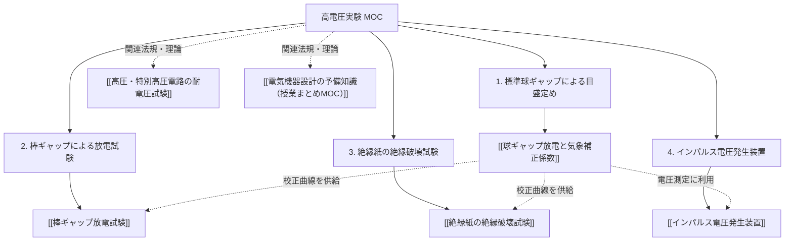

# ⚡ 高電圧実験 まとめ（MOC）

学校の実習・実験「高電圧実験（実験手順書）」における4大実験テーマ（標準球ギャップ、棒ギャップ、絶縁紙破壊、インパルス電圧発生装置）の目的、測定手順、重要公式、およびデータ解析手法を体系的に集約したまとめノート（Map of Content: MOC）です。

---

## 🗺️ 実験構成マップ

---

## 1. 🔬 4大実験テーマの要点と公式一覧

### ① [[球ギャップ放電と気象補正係数]]（標準球ギャップ目盛定め試験）
- **目的**: 準平等電界を持つ球ギャップを用いて、気象条件を補正した真の放電電圧を求め、一次側電圧計の目盛定め曲線（校正曲線）を作成する。
- **重要公式**:
  - **気象補正係数 $\delta$**:
    $$\delta = 0.289 \frac{b}{273 + t}$$
    （$b$: 気圧 $[\text{hPa}]$, $t$: 気温 $[^\circ\text{C}]$）
  - **放電電圧 $V$**:
    $$V = \delta V_n \quad [\text{kV}]$$
    （$V_n$: 標準状態における規定放電電圧）
  - **破壊電位の傾き $E$**:
    $$E = \frac{V}{d / 10} = \frac{10 V}{d} \quad [\text{kV/cm}]$$
    （$d$: ギャップ間隔 $[\text{mm}]$）
- **解析グラフ**:
  - 横軸：ギャップ長 $d \ [\text{mm}]$、縦軸：放電電圧 $V \ [\text{kV}]$ および破壊電位の傾き $E \ [\text{kV/cm}]$
  - 横軸：実験測定平均値 $V_2 \ [\text{kV}]$、縦軸：真の放電電圧 $V \ [\text{kV}]$（原点を通る校正曲線）

---

### ② [[棒ギャップ放電試験]]
- **目的**: 棒対棒の不平等電界における放電特性を調べ、球ギャップ（準平等電界）との破壊挙動の違いを比較する。
- **要点・手順**:
  - 棒ギャップ間隔 $d$ で3回放電し、平均測定値 $V_2$ を記録。
  - 実験①で作成した**目盛定め曲線**から真の放電電圧 $V \ [\text{kV}]$ を換算。
  - 破壊電位の傾き $E = \frac{10 V}{d} \ [\text{kV/cm}]$ を算出。
  - ギャップ長に対する放電特性曲線を描画。

---

### ③ [[絶縁紙の絶縁破壊試験]]
- **目的**: 平板電極と球電極間に挟んだ固体絶縁物（絶縁紙）の厚さ（積層枚数）と絶縁破壊電圧の関係を調べる。
- **要点・手順**:
  - 絶縁紙1枚の厚さ $t_0 = 0.25 \ \text{mm}$。
  - 積層枚数を増やし（1枚、2枚、3枚…）、破壊電圧 $V_2$ を測定（各3回平均）。
  - 目盛定め曲線から真の放電電圧 $V \ [\text{kV}]$ を換算。
  - **絶縁破壊の強さ（破壊電界）**:
    $$E_b = \frac{V}{0.25 N / 10} = \frac{40 V}{N} \quad [\text{kV/cm}]$$
    （$N$: 枚数）
  - 枚数の増加とともに単位厚さあたりの破壊強度が低下する「厚み効果」を確認。

---

### ④ [[インパルス電圧発生装置]]の出力特性試験
- **目的**: マルクス回路による急峻な衝撃波（雷インパルス電圧）を発生させ、50%放電電圧および装置の利用率を評価する。
- **要点・手順**:
  - 測定用球ギャップを規定値にセット。
  - 同一充電電圧で10回印加し、球ギャップの放電回数をカウント。
  - 放電率が **50%**（10回中5回放電）となる**全充電電圧 $V_c \ [\text{kV}]$** を同定。
  - **利用率 $\eta$ の算出**:
    $$\eta = \frac{V_c}{V_{\text{output\_max}}} \times 100 = \frac{V_c}{300} \times 100 \quad [\%]$$
    （定格出力 $300 \ \text{kV}$ に対する比率）
  - 全充電電圧 $V_c$ に対する出力電圧 $V$ の特性グラフを描画。

---

## 📚 参照資料
- 原本手順書PDF: [７．高電圧実験（手順書）.pdf](file:///c:/Users/kanat/OneDrive/新しいフォルダー/SecondBrain/Docs/７．高電圧実験（手順書）.pdf)（`SecondBrain/Docs/` に保管）

---

## 関連ノート
- [[電験三種 頻出要点攻略 MOC]]
- [[電気機器設計の予備知識（授業まとめMOC）]]
- [[高圧・特別高圧電路の耐電圧試験]]
- [[AGENTS|SecondBrain運用ルール（AGENTS.md）]]
