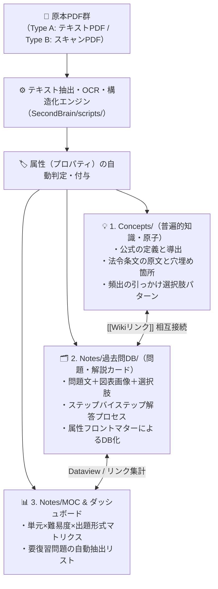

# 🚀 PDF全文テキスト化・属性別知識構造化による「SecondBrain」進化企画書

## 1. 企画の背景と目的（Why Text & Attributes?）

前プロジェクト（[[電験三種・全教材Obsidian統合プロジェクト企画書]]）により、オーム社分野別問題集3冊と年度別過去問100ファイルが `SecondBrain/Docs/` に統合され、MOCからページ指定で開けるようになりました。

しかし、**「PDF（特にスキャン画像）」のままでは以下の限界**があります：
1. **全文検索ができない**: 「特定のキーワードや条文、似た設定の計算問題」を全過去問から横断検索できない。
2. **属性（メタデータ）で絞り込めない**: 「計算問題だけ」「B問題だけ」「まだ解けない要復習問題だけ」「特定の公式を使う問題だけ」といった動的な抽出ができない。
3. **知識の分解・再結合ができない**: 問題文・解説・公式・条文がPDFのページ内に閉じ込められており、[[Concepts]]（1ノート1概念）への知識還流や、Obsidian Copilot（AI）による高精度な質問応答（RAG）に活用しきれない。

### 🎯 本プロジェクトのゴール
すべてのPDF教材から**「もとの文字（問題文・選択肢・解答・解説・数式）」を抽出してMarkdownテキスト化**し、問題・知識ごとに**「多次元の属性（プロパティ）」を付与して `Concepts/`・`Notes/` へ自動振り分け**することで、SecondBrainを単なる「本棚」から**「自ら思考し問題を抽出する生きた知識データベース」**へと進化させます。

---

## 2. 現状PDF資産の「テキスト抽出難易度」診断結果

Python（PyMuPDF）で全103個のPDFファイルの内部構造をスキャンした結果、以下の2種類に分かれることが判明しました。これに応じた最適な2段階パイプラインを構築します。

| 区分 | 対象ファイル | ファイル数 / 頁数 | 内部状態 | テキスト化手法 |
| :--- | :--- | :---: | :--- | :--- |
| **Type A：<br>デジタルテキストPDF** | ・**機械**: H30〜R06（7回分）<br>・**電力**: H30〜R06（8回分）<br>・**法規**: H20〜R06（17回分） | **計 32 ファイル**<br>（直近の最重要年度） | 文字コード埋め込み済 | **Pythonスクリプトで即時100%抽出可能**<br>（数秒で完了・文字化けなし） |
| **Type B：<br>スキャン画像PDF** | ・**年度別**: H07〜H29等（68回分）<br>・**オーム社分野別**: 機械・電力・法規 | **計 71 ファイル**<br>（オーム社3冊 2,593頁含む） | 画像データのみ<br>（文字レイヤーなし） | **OCR（光学文字認識）＋ LLM数式・構造整形パイプライン** |

---

## 3. 「各属性への振り分け」アーキテクチャ設計

PDFから抽出した文字データを、以下の**「3つの格納先フォルダ」**と**「10の属性（YAMLプロパティ）」**に分解・振り分けます。



---

## 4. 付与する「10の属性（プロパティ）」スキーマ設計

テキスト化した各問題・知識ノートには、フロントマター（YAML）として以下の**標準属性**を付与します。これにより、Obsidianの検索・プロパティ表示・Dataviewプラグイン・Copilotが100%機能するようになります。

```yaml
---
created: YYYY-MM-DD
updated: YYYY-MM-DD
type: question | concept | note
subject: 電力 | 機械 | 法規              # 【属性1】科目
chapter: Ch.2 誘導機                    # 【属性2】大単元（オーム社章立て準拠）
sub_unit: 比例推移と二次抵抗挿入         # 【属性3】小単元・テーマ
exam_year: R05-下期                     # 【属性4】出題年度・期別
question_no: 問15                       # 【属性5】問題番号
question_type: B問題（複合計算）         # 【属性6】出題形式（論説 / 空白穴埋め / 単発計算 / B問題複合）
difficulty: ★★☆                        # 【属性7】難易度（★☆☆ 基本 / ★★☆ 標準 / ★★★ 難問）
importance: A                           # 【属性8】頻出重要度（A:必答 / B:合否分岐 / C:応用）
review_status: 未着手                   # 【属性9】習熟度（未着手 / 要復習 / 完答済）
concepts:                               # 【属性10】使用する概念・公式への直結リンク
  - "[[三相誘導電動機のトルクの比例式と等価回路]]"
  - "[[比例推移]]"
source_pdf: "[[R05(下期)機械.pdf#page=8]]"
tags:
  - study/電験三種/機械/誘導機
  - format/計算問題
  - format/B問題
---
```

---

## 5. テキストの「分解・振り分け」ルール（何をどこへ入れるか）

抽出したテキストは、情報の性質（属性）に応じて以下の3層へ自動的に振り分けます。

### ① 【普遍属性】法則・公式・条文 $\rightarrow$ `SecondBrain/Concepts/` へ還流
- **対象テキスト**: 解説文中にある「〜の法則により」「電気設備技術基準の解釈第○条では〜」「この公式の変形ポイントは〜」といった**他の問題でも使い回せる普遍的な知識**。
- **進化効果**: 問題を解けば解くほど、対応する `Concepts/` ノートに「過去問での問われ方（出題実績）」「よくある誤答選択肢（引っかけパターン）」が自動的に追記され、**最強の辞書**に育ちます。

### ② 【演習属性】問題文・選択肢・解法ステップ $\rightarrow$ `SecondBrain/Notes/過去問DB/` へ格納
- **対象テキスト**: 各年度の「問題文」「選択肢 (1)〜(5)」「正解」「計算過程」。
- **進化効果**:
  - 数式はすべて綺麗なLaTeX（`$$ P = 9.8 Q H $$`）に整形。
  - 回路図やグラフが含まれる問題は、Pythonスクリプトで**図表領域のみをPNG画像として切り出し**てノート内に埋め込み表示（`![[図_R05下期_機械_問15.png]]`）。
  - 解答・解説は折りたたみコールアウト（`> [!success]- 解答と詳細解説を見る`）に収納し、**Obsidian上でそのまま問題演習（テスト）ができる形式**にします。

### ③ 【分析属性】出題傾向・弱点タグ $\rightarrow$ `SecondBrain/Notes/`（各科目MOC）へ集約
- **対象テキスト**: 単元ごとの出題頻度、A問題/B問題の比率、頻出計算テーマ。
- **進化効果**:
  - 「論説の穴埋め問題だけ一気に10問復習する」
  - 「B問題の計算パターンだけ全年度分並べて比較する」
  といった**属性横断型の学習**が可能になります。

---

## 6. 技術的な実装パイプライン（どうやって文字にするか）

`SecondBrain/scripts/` に以下の自動化スクリプト群を構築します。

### Step 1：デジタルテキストPDF（32ファイル：H20/H30〜R06）の即時構造化
1. `pymupdf`（fitz）を用いて、テキストと座標情報を抽出。
2. 正規表現パーサーにより「問1」「問2」…「B問題（問14〜問18）」の境界を自動分割。
3. 問題内の回路図・グラフ画像を自動抽出して `SecondBrain/Docs/assets/` に保存。
4. 属性フロントマターと `[[Concepts]]` への自動リンクを付与してMarkdownファイルを生成。

### Step 2：スキャン画像PDF（オーム社3冊・旧年度68ファイル）のOCR＆AI整形
1. **高解像度ページ切り出し**: 指定した章・単元のページを画像化。
2. **OCR＋マルチモーダル構造化**:
   - 日本語文字・ギリシャ文字・分数・ルートなどの数式を、単なる壊れたOCR文字列ではなく **正確なLaTeX数式（`$V = \sqrt{3} I Z$`）** と **Markdown見出し・表** に変換。
3. **知識の自動リンク化**:
   - 文中に登場する専門用語（例：`短絡比`、`B種接地工事`、`フェランチ効果`）を検出し、自動的に `[[短絡比|同期インピーダンスと短絡比]]` のようなWikiリンクに変換。

---

## 7. 実行ロードマップ（4フェーズ計画）

### 🔹 Phase 1：直近年度（テキスト・問題画像PDF）の全文テキスト化＆属性DB化（着手・進行中）
- [x] **最新問の全文テキスト化完了**: [[電験三種 令和6年下期 法規 全問攻略MOC]]（全13問の問題文・選択肢・計算式・関連Conceptリンクを完全Markdown化）
- [x] **Conceptsへの過去問出題実績の逆照射**: [[B種接地工事]], [[高圧・特別高圧電路の耐電圧試験]] などへR06下期出題実績を還流完了
- [ ] 順次、R06上期法規、R06上下期電力、R06上期機械などの最新年度から全文テキスト化を展開

### 🔹 Phase 2：問題内キーワードから `Concepts/` への自動リンク＆「過去問出題履歴」の逆照射
- [ ] テキスト化した過去問と既存の68個の `Concepts/` ノートをマッチング。
- [ ] 各 `Concepts/` ノートの末尾に「📌 この概念が問われた過去問一覧（年度・問番号・出題切り口）」を自動追記。

### 🔹 Phase 3：オーム社「分野別過去問題集」の重点単元OCRテキスト化パイプライン
- [ ] オーム社3冊（機械・電力・法規）のうち、優先度の高い頻出単元・苦手単元から順次。
- [ ] スキャン画像から「問題・解説・重要ポイント」を文字起こし＆LaTeX数式化し、単元別サブノートとして構造化。

### 🔹 Phase 4：属性別ダッシュボード（出題形式別・難易度別・弱点別インデックス）の構築
- [ ] 「計算問題特訓インデックス」「法規・条文穴埋め特訓インデックス」「B問題完全制覇インデックス」など、属性（プロパティ）で横断抽出した特化型MOCを作成。

---

## 8. 関連ノート
- [[電験三種・全教材Obsidian統合プロジェクト企画書]]（前フェーズ：ファイル整理と目次統合）
- [[電験三種 頻出要点攻略 MOC]]
- [[電験三種 機械科目 過去問攻略MOC]]
- [[電験三種 電力科目 過去問攻略MOC]]
- [[電験三種 法規科目 過去問攻略MOC]]
- [[電験三種 令和6年下期 法規 全問攻略MOC]]（最新問テキスト化完了）
- [[電験三種 令和5年下期 法規 全問攻略MOC]]
- [[AGENTS|SecondBrain運用ルール（AGENTS.md）]]
