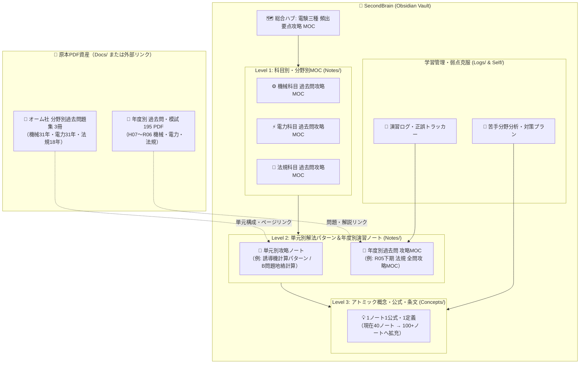

# 📋 電験三種・全教材Obsidian統合プロジェクト企画書

## 1. プロジェクトの背景と目的（Purpose & Goal）

現在、ワークスペースルート（`新しいフォルダー`）には、**オーム社の分野別過去問題集3冊（計約1.12 GB）** と **平成7年〜令和6年までの年度別過去問・模擬試験PDF（計195ファイル）** という極めて充実した学習資産が集約されています。

本プロジェクトの目的は、これらの膨大なPDF資料を単なる「静的なファイル置き場」にとどめず、Obsidian（`SecondBrain`）の **Wikiリンク `[[ ]]`**・**階層タグ**・**MOC（Map of Content）** を駆使して、**「どの問題でつまずいても、必要な公式・条文・類題へ1クリックで辿り着ける合格直結型の知識ネットワーク」** として完全統合することです。

---

## 2. 現状資産（アセット）の棚卸し

現在 `新しいフォルダー` 内に存在する全リソースは以下の通りです。

### ① 分野別過去問題集（オーム社・大型PDF 3冊）
| ファイル名 | 対象科目 | 収録範囲 | 容量 | 特徴・位置づけ |
| :--- | :---: | :---: | :---: | :--- |
| `電験3種_機械_分野別過去問題集_過去31年分_オーム社_全ページ.pdf` | **機械** | 過去31年分 | 459 MB | 単元別・テーマ別に体系化された最重要演習書 |
| `電験3種_電力_分野別過去問題集_過去31年分_オーム社.pdf` | **電力** | 過去31年分 | 399 MB | 発電・変電・送配電の分野別網羅演習書 |
| `電験3種_法規_分野別過去問題集_過去18年分_オーム社.pdf` | **法規** | 過去18年分 | 265 MB | 条文・計算パターン別の体系的演習書 |

### ② 年度別過去問・模擬試験フォルダ（3フォルダ・計195 PDF）
| フォルダ名 | ファイル数 | 収録年度 | 備考 |
| :--- | :---: | :---: | :--- |
| `機械_模擬試験問題/` | **128 PDF** | H07 〜 R06 | 年度別問題・解答解説（サブフォルダ `過去問(H21～R6)` 含む） |
| `電力_模擬試験問題/` | **34 PDF** | H07 〜 R06 | 年度別問題・解答解説（上期・下期含む） |
| `法規_模擬試験問題/` | **33 PDF** (+1 ZIP) | H07 〜 R06 | 年度別問題・解答解説（展開済みの `H10法規.zip` 322MB 含む） |

### ③ 構築済みの `SecondBrain/` ノート資産
- **`Concepts/`（現在40ノート）**: 理論水力、誘導機トルク比例式、変圧器短絡試験、P-V曲線、非接地地絡電流計算など「1ノート1概念」のアトミックノート群。
- **`Notes/`（現在7ノート）**: [[電験三種 頻出要点攻略 MOC]] を頂点とする各科目MOC・授業まとめMOC・高電圧実験MOC。
- **`Docs/`**: `７．高電圧実験（手順書）.pdf`

---

## 3. Obsidian統合アーキテクチャ設計

「分野別問題集（タテ糸）」と「年度別過去問（ヨコ糸）」を、Obsidianの「アトミック概念ノート（交差点）」で結ぶ **3層知識ネットワーク構造** を構築します。

---

## 4. 具体的な整理・統合ポリシー

### 方針1：PDFファイルの格納場所とリンク方式
Obsidianの標準機能では、Vault内（`SecondBrain/Docs/`）にPDFを配置すると **`[[ファイル名.pdf#page=15|オーム社機械 P.15]]`** のように特定ページを直接開くWikiリンクが使えるようになります。
- **推奨構成**:
  - `SecondBrain/Docs/分野別問題集_オーム社/` にオーム社PDF 3冊を移動
  - `SecondBrain/Docs/過去問_年度別/` に `機械_模擬試験問題`・`電力_模擬試験問題`・`法規_模擬試験問題` を移動
  - 不要な重複圧縮ファイル（`法規_模擬試験問題/H10法規.zip` 約322MB）および整理済みの `_inbox/無題のファイル.md` を削除・整理してストレージを節約

### 方針2：オーム社「分野別過去問題集」の攻略ノート化
400MB前後の超大型PDFを人間が最初からめくるのは負担が大きいため、**Pythonスクリプト（`SecondBrain/scripts/`）** を用いて目次ページ・章扉ページを自動抽出し、オーム社の章立てに完全対応した **「単元別インデックス＆ページジャンプ付きMOC」** を `Notes/` に作成します。

### 方針3：タグ体系とステータス管理（弱点可視化）
フロントマターのタグとステータスを活用し、学習進捗を一目で把握できるようにします。
- **科目・単元タグ**: `study/電験三種/機械/誘導機`, `study/電験三種/電力/送配電`, `study/電験三種/法規/施設管理`
- **習熟度タグ（演習ノート用）**:
  - `review/要復習`（間違えた問題・うろ覚えの概念）
  - `review/頻出Aランク`（落としてはいけない必修問題）
  - `review/完答済`（自力で解けるようになった問題）

---

## 5. 実行ロードマップ（4フェーズ計画）

### 🔹 Phase 1：フォルダ構造の統合とクリーンアップ（完了）
- [x] `新しいフォルダー` 直下のPDFフォルダ3つとオーム社PDF3冊を `SecondBrain/Docs/` 配下へ整理移動
- [x] 解凍済みで重複している `法規_模擬試験問題/H10法規.zip`（322MB）の削除および整理済みの `_inbox/無題のファイル.md` を `Docs/` へアーカイブ完了

### 🔹 Phase 2：オーム社3冊（機械・電力・法規）の目次解析＆単元マップ構築（完了）
- [x] PyMuPDFを用いた目次スキャン・ページ解析を実施（機械12章・1095頁、電力10章・931頁、法規10章＋付録・567頁）
- [x] オーム社問題集の章・問数・ページ番号と直結するWikiリンク（`#page=N`）を各科目MOC（[[電験三種 機械科目 過去問攻略MOC]] / [[電験三種 電力科目 過去問攻略MOC]] / [[電験三種 法規科目 過去問攻略MOC]]）に完全統合

### 🔹 Phase 3：頻出単元のアトミックノート（`Concepts/`）重点拡充（完了）
- [x] **法規科目**: [[事業用電気工作物の自主保安体制と保安規程・主任技術者]], [[電気工事士の作業範囲（第一種・第二種）]], [[電気用品安全法（特定電気用品とPSEマーク）]]
- [x] **電力科目**: [[原子力発電の原理と軽水炉（BWR・PWR）]], [[遮断器の種類（GCB・VCB）と消弧原理]], [[避雷器（酸化亜鉛形避雷器）と制限電圧]], [[地中電線路の電力損失（誘電体損・シース損）と許容電流]]
- [x] **機械科目**: [[インバータ制御（PWM制御・変調率）]], [[ファラデーの電気分解の法則と電池]], [[論理回路と論理式（ブール代数・ド・モルガンの定理）]]

### 🔹 Phase 4：年度別過去問の演習トラッカー＆重点年度MOC化（基盤完了）
- [x] 機械・電力・法規の全33〜34回分（H07〜R06）の年度別原本PDFリンク付き得点演習トラッカーテーブルを各科目MOCに完備
- [ ] 苦手問題や直近年度の個別深掘り演習ノートの随時追加（運用フェーズへ移行）

---

## 6. 関連ノート
- [[電験三種 頻出要点攻略 MOC]] - 電験三種全体の総合ハブ
- [[電験三種 機械科目 過去問攻略MOC]]
- [[電験三種 電力科目 過去問攻略MOC]]
- [[電験三種 法規科目 過去問攻略MOC]]
- [[電験三種 令和5年下期 法規 全問攻略MOC]]
- [[AGENTS|SecondBrain運用ルール（AGENTS.md）]]
